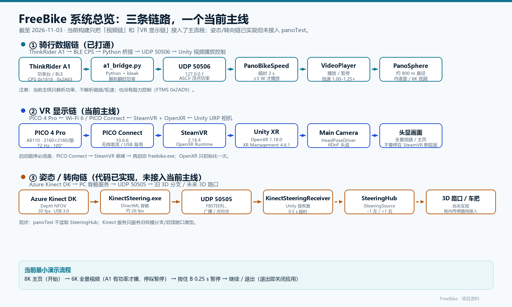
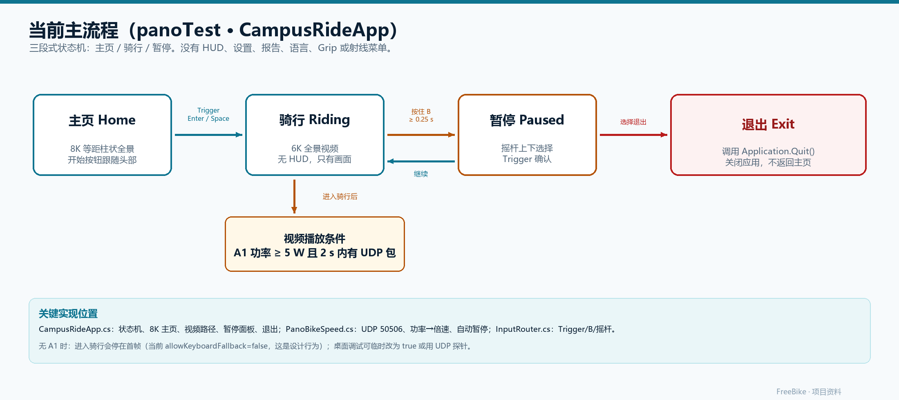

# 项目资料

**FreeBike 校园 360° 沉浸式骑行 Demo**

新队友交接手册 · 2026-11-03

| 项目 | 内容 |
|---|---|
| 文档版本 | v1.0（交接版） |
| 适用工程 | `D:\freebike` |
| 当前主线 | PC VR：`Assets/Scenes/panoTest.unity` + `CampusRideApp` |
| 目标头显 | PICO 4 Pro（A8110） |
| 资料截止 | 2026-11-03 |
| 维护者 | FreeBike 项目组 |
| 文档定位 | 给新队友的项目说明、环境手册、演示 SOP 和排障入口 |

> 这份资料回答四个问题：**这个项目现在是什么、已经实现了什么、需要什么软硬件、接下来怎么继续。**  
> 它不是 AI 续作文档。AI 续作请读 `Docs/AI/FreeBike_项目交接文档.md`；两者冲突时，以当前代码和本资料的“现状”章节为准。

---

## 0. 30 秒速览

### 0.1 一句话

FreeBike 是一套**室内自行车 + PICO 4 Pro 的沉浸式校园骑行 Demo**：真实骑行台提供功率，PC 端 Unity 渲染 360° 全景视频，通过 PICO Connect + SteamVR/OpenXR 串流到头显；踩得越用力，视频播放越快，停踩就暂停。

### 0.2 现在能演示什么

- 8K 等距柱状校园全景主页，正前方一个「开始」按钮。
- 开始后进入 6K 360° 全景视频，头显可以自然转头环顾。
- ThinkRider A1 骑行台通过 BLE → Python 桥接 → UDP 50506 把功率送进 Unity。
- 有功率（≥5 W）视频播放；停踩或 2 秒无数据自动暂停；播放倍速随功率从 1.00× 升到 1.25×。
- 骑行中按住 B 约 0.25 秒暂停；摇杆上下选择「继续 / 退出」，Trigger 确认。
- 选「退出」会直接关闭应用，不会回主页。

### 0.3 现在还不能做什么

- 没有 3D 校园、没有 3D 路口、没有真正的车把转向。
- 当前主线没有第一人称自行车/车把模型、没有 HUD、没有心率、没有报告、没有多语言、没有设置页、没有 Grip 调面板、没有手柄射线菜单。
- 不解析踏频/轮速，不做阻力控制（FTMS 0x2AD9）。
- 没有音频：当前 6K HEVC 文件没有音轨，演示是静音的。
- Kinect 转向服务代码在，但没有接进当前 `panoTest` 主流程。
- PICO Motion Tracker、原地跑步、语音指令、AI 教练、音乐都还没做。

### 0.4 三个必须先解决的问题

| 优先级 | 问题 | 为什么重要 | 下一步 |
|---|---|---|---|
| P0 | 头显里可能仍停在 SteamVR 面板/影院层，而不是应用全景 | 这是最后一份运行报告里明确记录的未闭环项，直接决定能不能演示 | 按 §9 的启动顺序、单实例、前台窗口处理，并用最新日志确认 `FOCUSED` 后画面是否真的切到应用 |
| P0 | OpenXR 只启用了 Khronos Simple Controller Profile | B/Trigger/Grip 可能没有完整映射，暂停和确认会失效 | 在 OpenXR 设置中启用与 PICO Connect 匹配的 Profile，逐键验证 Trigger/B/Grip |
| P0 | 6K HEVC 在 Unity 内的最终播放/硬解还没有完整验收，且构建没有自带视频 | 视频放不出来或换机就黑屏，演示会直接失败 | 重建、复制视频到 `StreamingAssets`、看任务管理器 Video Decode、按 §11 验收 |

### 0.5 新人第一周建议

1. **第 1 天**：按 §8 装环境，打开工程，先跑通 `C:\Users\admin\Desktop\bikedemo\freebike.exe`，不要急着改代码。
2. **第 2 天**：读 `CampusRideApp.cs`、`PanoBikeSpeed.cs`、`InputRouter.cs`，画出三态流程；运行 A1 桥接，确认 UDP 50506 有数据。
3. **第 3 天**：自己构建一次 Windows 包，把 6K 视频复制进 `StreamingAssets`，验证换目录也能播。
4. **第 4 天**：配置 OpenXR Profile，进头显逐项测试 Trigger/B/摇杆；记录日志和实际现象。
5. **第 5 天**：从 §14 里挑一个边界清晰的小目标（例如一键启动脚本或单路口原型），先给计划再动手。

---

## 1. 项目是什么

### 1.1 产品目标

最初的目标是：在 PICO 4 Pro 里做一套真正的室内沉浸式骑行/健身应用。

- 真实自行车固定在骑行台上，A1 提供功率、踏频、速度。
- 头显里看到校园 360° 场景，可以自然转头环顾。
- 方向控制尽量不用手柄摇杆，优先用身体/车把姿态。
- 未来加入校园混合场景、原地跑步、语音指令、AI 教练、音乐。
- 体验要求：清晰、稳定、长时间佩戴不晕。

### 1.2 当前实际形态（重要）

2026-10-27 做了一次明确的**功能减法**：演示只需要“看风景”，所以当前主线被收敛成三段式：

```text
主页（8K 全景 + 开始）
  └→ 骑行（6K 全景视频，无 HUD）
        └→ 按住 B 0.25 s → 暂停（继续 / 退出）
```

这意味着：

- 当前交付物是一个**PC VR 演示**，不是头显独立 APK。
- 画面是**实拍 360° 视频**，不是 3D 校园。
- 没有自行车模型和车把，用户看到的就是全景画面。
- 交互被刻意压到最少：开始、暂停、继续、退出。
- 旧版的一体机 3D 分支和大量 UI 代码仍然留在工程里，但不属于当前主线。

> 如果你接手后听到“为什么没有 HUD/心率/报告”，先确认对方说的是**当前主线**还是**旧一体机分支**。这两套东西都在仓库里，但入口和体验完全不同。

### 1.3 三条技术路线

| 路线 | 入口/场景 | 运行形态 | 现状 | 用途 |
|---|---|---|---|---|
| A. 当前主线：PC VR 全景 | `Assets/Scenes/panoTest.unity` | Windows exe + PICO Connect + SteamVR/OpenXR | **正在维护** | 当前演示、后续校园混合场景的基础 |
| B. 旧一体机 3D 分支 | `Assets/BrokenVector/LowPolyRoadPack/Demo/Low Poly Road Pack Demo.unity` | Android APK，头显独立运行 | 代码保留，非当前重点 | 参考完整 UI、占位自行车、BLE/Kinect 接入方式 |
| C. 转向/传感器研发 | `Tools/KinectSteering`、`Assets/Scripts/Bike/SteeringSensor.cs` | PC 服务 + Unity 接口 | 部分实现，未接主线 | 未来 3D 路口连续转向、车把角度采集 |

### 1.4 文档可信度与冲突说明

项目里文档很多，时间跨度大，**不能默认每份都是最新**。推荐顺序：

1. **当前代码**：`CampusRideApp.cs`、`PanoBikeSpeed.cs`、`panoTest.unity`。
2. **本资料**：面向新队友的现状汇总（2026-11-03）。
3. **运行报告**：`Docs/Reports/FreeBike_工作报告_2026-10-29.docx`，对视频/VR 排障过程最有价值。
4. **AI 交接文档**：`Docs/AI/FreeBike_项目交接文档.md`，保留了大量历史和数据链路细节，但部分“当前状态”已过时。
5. **旧安装清单/UI 指南**：适合查历史方案，不要直接照做。

已知的文档冲突，先在这里说清楚：

| 冲突点 | 旧文档说法 | 当前实际 | 以哪个为准 |
|---|---|---|---|
| 当前 UI | AI 交接文档 §12.3 仍写 HUD、心率、报告、五语言、Grip、射线菜单 | `CampusRideApp` 已是 Home/Riding/Paused 三态；射线组件在 `Start()` 里被关闭 | 代码 |
| 暂停后的「退出」 | 10-27 改动说明和运行报告写“回主页” | 当前源码和已编译的 `Assembly-CSharp.dll` 都调用 `Application.Quit()` | 代码/构建 |
| SteamVR | 旧安装清单写“不要装 SteamVR” | 那是旧 APK 路线；当前 PC 主线必须用 PICO Connect + SteamVR | 本资料 |
| 踏频/轮速 | README 写“尚未接入” | 当前主线确实只有功率；旧分支有 CPS/FTMS 解析器，但未在主线验证 | 分路线看 |
| 源码与构建 | 文档默认 exe 与源码同步 | 源码文件时间晚于最新归档构建，交付前必须重编 | 重新构建后再判断 |

> 工作原则：**代码为准、实机为准、日志为准。** 任何“应该可以”都要用一次构建或一次头显测试换掉。

---

## 2. 系统总览

### 2.1 三条链路



系统可以拆成三条独立的流：

1. **骑行数据流**：A1 → BLE CPS → `a1_bridge.py` → UDP 50506 → `PanoBikeSpeed` → `VideoPlayer`。这条链目前只传功率，已经实测打通。
2. **VR 显示流**：Unity 相机 → OpenXR → SteamVR → PICO Connect → PICO 4 Pro。应用必须在 SteamVR 就绪后启动，否则 OpenXR 只初始化一次，失败后不会重试。
3. **姿态/转向流**：Azure Kinect → USB 3.0 → `KinectSteering.exe` → UDP 50505 → `KinectSteeringReceiver` → `SteeringHub`。这条链代码在，但没有接进当前主线；未来的 3D 路口才会真正需要它。

### 2.2 当前主流程



对应的代码状态机只有三个状态：

```csharp
enum UiState { Home, Riding, Paused }
```

没有 Boot、Settings、Results、Report 等页面。旧 `RideUi` 的完整状态机只在旧一体机分支生效。

### 2.3 一次骑行的完整时序

1. 启动应用，`CampusRideApp.Start()` 找到相机、`PanoSphere`、`PanoBikeSpeed`。
2. 关闭场景里重复的 `PanoSphere (1)`，避免两个球重叠、两个 UDP 监听抢 50506。
3. 配置视频路径，`VideoPlayer.Prepare()`；创建主页 UI。
4. `GoHome()`：显示 8K 主页球，隐藏视频球，视频暂停。
5. 用户按 Trigger / Enter / Space，`StartRide()`：隐藏主页，显示视频球，视频保持暂停。
6. PC 上的 `a1_bridge.py` 持续把功率发到 127.0.0.1:50506。
7. `PanoBikeSpeed.Update()` 读取 UDP；2 秒内有包且平滑功率 ≥5 W 时 `video.Play()`，否则 `video.Pause()`。
8. 视频播放速度按功率从 1.00× 平滑升到 1.25×。
9. 用户按住 B ≥0.25 秒，`PauseRide()`：视频暂停，显示暂停面板。
10. 摇杆上下选择「继续 / 退出」，Trigger 确认；继续回到视频，退出调用 `Application.Quit()`。

### 2.4 当前 UI 的空间关系

- 主页 Canvas 是**相机的子物体**，位于相机前方约 2.2 m，按钮中心略低于视线 0.12 m。
- 暂停 Canvas 也是相机子物体，位于前方约 1.6 m，带 0.62 的黑色压暗层。
- 因此当前 UI 是“跟随头部”的，不是固定在房间里的世界面板；没有 Grip 平移。
- UI 全部由代码运行时生成，没有使用 `CampusRideUI.prefab`。

---

## 3. 硬件与外设

### 3.1 核心设备

| 类别 | 设备/型号 | 关键参数 | 连接方式 | 当前状态 | 备注 |
|---|---|---|---|---|---|
| 头显 | PICO 4 Pro，型号 A8110 | 单眼 2160×2160，105°，约 20.6 PPD，72 Hz 目标，8 GB RAM，512 GB 存储，Wi-Fi 6 | PICO Connect 无线串流；USB 3.0 备用 | 正常；本次核对未连接 | 序列号 PA8210MGJ5160306G，资产信息勿外传 |
| 手柄 | PICO 4 Pro 左右手柄 | 6DoF，Trigger、B、Grip、摇杆 | 头显 6DoF 追踪 | 正常；映射待验证 | 当前只依赖 Trigger/B/摇杆 |
| 骑行台 | ThinkRider A1（智骑 A1，固件也显示 Think A102） | BLE CPS 0x1818 / 0x2A63，约 1 Hz 功率上报 | BLE 到 PC | 已实测 26–35 W，停踩 0 W | 蓝牙地址 `F5:79:6C:84:32:07`，纽扣电池供电 |
| 姿态相机 | Azure Kinect DK | Depth NFOV Unbinned，30 fps；Color 1.6.110 / Depth 1.6.79 | USB 3.0 | 代码可用；本次核对时设备未识别 | 序列号 MSFT20000028402912；USB 3.0 链路敏感 |
| PC | Lenovo 21LE | Ultra 9 185H，16 核 22 线程，32 GB，RTX 4060 Laptop 8 GB + Intel Arc | — | 正常 | Windows 11 26300；Wi-Fi 6E AX211；当前 WLAN 192.168.31.210/24 |
| 路由器 | 5 GHz / Wi-Fi 6 路由 | PC 与头显同一网段 | 无线 | 正常 | 当前 SSID `VR_01`；PC 无线协商 866.7 Mbps |
| 跑步追踪器 | PICO Motion Tracker | 计划用于原地跑步 | 未接入 | 未购买/未接入 | 远期 |
| 转向传感器 | AS5600 或 AS5048A + 径向磁铁 + ESP32-C3 | 磁角度，I2C/SPI，BLE | 未接入 | 方案阶段 | 见 §7.3 |
| 开发板 | ESP32-C3-MINI-1 | BLE 5、RISC-V、USB | 未接入 | 未采购/未验证 | 首版转向采集器主控 |

### 3.2 设备连接与摆放

**骑行台与自行车**

- 自行车固定在内骑行台上，车架相对固定；转向传感器测的是把立/前叉相对车架的转角。
- A1 用纽扣电池供电；长时间不用建议取出，避免漏液。
- A1 同时只能被一个中心连接。手机上的 ThinkRider Tools、OnelapFit 等 App 要先断开，否则 PC 连不上。
- PC 蓝牙天线尽量靠近骑行台，中间不要隔金属/人体；BLE 丢包会直接表现为视频卡顿或暂停。

**Azure Kinect**

- 放在骑行者前方 1.5–2.5 m，镜头能看到上半身（肩、手、髋）。
- 避免逆光、强阳光直射和反光地面；深度相机对黑色吸光材料也不友好。
- 必须用**短认证 USB 3.0 线**直插 PC 的蓝色 USB 3.0 口，不要用充电线、长线、扩展坞。
- 固定牢靠，避免骑行震动导致掉线；可以用三脚架或夹具。

**PICO 4 Pro**

- 建议 2 m × 2 m 安全区，地面清理线缆；骑行台在安全区中心。
- 头显与 PC 在同一 5 GHz Wi-Fi；路由器尽量靠近，最好不要隔墙。
- 无线串流不稳时，改用 USB 3.0 连接（PICO Connect 支持有线模式），但要注意线缆拉扯。
- 不要在阳光直射下使用头显，避免镜头灼伤。

**PC**

- 演示时插电，开启性能模式；6K 解码 + VR 渲染会让笔记本发热降频。
- 独显直连/混合输出设置确保 Unity 使用 RTX 4060，而不是 Intel Arc 核显。
- 关闭不必要的后台程序，尤其是另一个 `freebike.exe`、视频播放器、浏览器硬件加速。

### 3.3 线材、耗材与工具

| 物品 | 用途 | 备注 |
|---|---|---|
| USB-C 数据线 | PICO 有线串流/adb | 要支持数据传输，不是纯充电线 |
| USB 3.0 A-to-B 短线 | Kinect | 认证线，尽量 < 3 m，直插 |
| 三脚架/夹具 | Kinect 固定 | 高度可调，避免震动 |
| 骑行台地垫 | 防滑、减震、保护地板 | 可选 |
| 风扇 | 骑行散热、减少出汗 | 推荐 |
| 纽扣电池 | A1 | 按电池仓标注型号，常见 CR2032；以实物为准 |
| 万用表/示波器 | 转向传感器调试 | 测电压、I2C/SPI 波形 |
| 3D 打印机 | 传感器支架 | 首版可拆支架，避开刹车/变速线 |
| 电烙铁/焊锡 | PCB/开发板 | 转向采集器打样后使用 |
| 7-Zip | 工程打包/传输 | 排除 Library、Temp、Releases 大文件 |

### 3.4 采购/替代建议

- **不要**用 MPU6050/BNO055 做第一版转角传感器：它们测姿态，受安装方向和漂移影响，不适合绝对转角。
- **不要**买只有脉冲计数的普通增量编码器：断电后要重新找零点。
- 原型首选 AS5600 模块 + 直径约 6 mm 径向充磁磁铁 + ESP32-C3 开发板；成品升级 AS5048A（SPI，14 位）。
- 采购前先量：把立/头管结构、可用安装间隙、左右最大转角、磁铁与芯片的同轴距离。
- Kinect 二手采购要确认 USB 3.0 能枚举出 Depth Camera，避免只拿到麦克风/HID。

---

## 4. 软件与工具

### 4.1 开发机软件清单

| 软件 | 版本（本机实测/工程锁定） | 用途 | 必需性 | 安装位置/备注 |
|---|---|---|---|---|
| Windows | Windows 11 64 位，26300 | 开发/演示系统 | 必需 | 建议 32 GB 内存、RTX 4060 级别独显 |
| Unity Hub | 3.22.4 | 管理 Unity 版本 | 必需 | `C:\Program Files\Unity Hub` |
| Unity Editor | 6000.6.6f1（d20c9ac777da） | 工程/构建 | 必需 | `C:\Program Files\Unity\Hub\Editor\6000.6.6f1` |
| Windows Build Support | 随 Unity 安装 | 构建 PC exe | 必需 | `WindowsStandaloneSupport` 已安装 |
| Android Build Support | 随 Unity 安装（SDK/NDK/OpenJDK） | 构建旧 APK 分支 | 仅 APK 需要 | `AndroidPlayer` 已安装 |
| OpenJDK | Temurin 17.0.18 | Android 插件/打包 | 仅 APK/插件 | Unity 自带，不要另装 JDK |
| Android SDK | platforms 34/36/37 | Android 打包 | 仅 APK/插件 | Unity 自带 |
| Android NDK | r27c（27.2.12479018） | IL2CPP | 仅 APK | Unity 自带 |
| .NET SDK | 10.0.402 | 编译 `KinectSteering` | 仅 Kinect | `dotnet --list-sdks` 验证 |
| Python | 3.14.3 | 运行 A1 BLE 桥接 | 需要 A1 时必需 | `C:\Users\admin\AppData\Local\Python\pythoncore-3.14-64\python.exe` |
| bleak | 3.0.2（随工程携带） | Python BLE | 随桥接 | `Tools/deps/.pydeps-ble`，不需要 pip 安装 |
| PICO Connect | 10.6.6 | 头显串流 | 必需 | `D:\pico\PICO Connect` |
| SteamVR | 2.18.4（报告记录） | OpenXR Runtime/合成 | 必需 | `D:\Steam\steamapps\common\SteamVR` |
| HEVC 视频扩展 | Microsoft.HEVCVideoExtension 2.5.48 | 6K HEVC 解码 | 必需 | Microsoft Store/系统组件 |
| Azure Kinect Sensor SDK | 1.4.2 | Kinect 设备/工具 | 仅 Kinect | `C:\Program Files\Azure Kinect SDK v1.4.2` |
| Azure Kinect Body Tracking SDK | 1.1.2 | 骨骼追踪 | 仅 Kinect | `C:\Program Files\Azure Kinect Body Tracking SDK` |
| ffmpeg | 7.1（imageio 构建） | 视频转码/检查 | 建议 | `Tools/ffmpeg/.../ffmpeg-win-x86_64-v7.1.exe` |
| Git | 任意近期版本 | 版本管理 | 建议 | 仓库已初始化但还没有 commit |
| 7-Zip | 任意近期版本 | 工程打包 | 建议 | 排除大文件 |
| VS Code / Visual Studio | VS Code 1.143.1 / VS 2022/2026 | 编辑/调试 | 可选 | Unity 会生成 sln/csproj |
| Office / WPS | 任意 | 文档 | 可选 | 本资料即 Word 版 |
| nRF Connect（手机） | 最新 | BLE 排查 | 可选 | 查 A1 服务/特征 |

### 4.2 Unity 包与版本（`Packages/manifest.json`）

| 包 | 版本 | 用途 |
|---|---|---|
| `com.unity.render-pipelines.universal` | 17.6.0 | URP 渲染 |
| `com.unity.xr.interaction.toolkit` | 3.6.1 | XRI（旧 UI/交互） |
| `com.unity.xr.management` | 4.6.1 | XR 加载管理 |
| `com.unity.xr.openxr` | 1.18.0 | Windows OpenXR |
| `com.unity.inputsystem` | 1.20.0 | 输入 |
| `com.unity.xr.core-utils` | 2.6.0 | XR 工具 |
| `com.unity.ugui` | 2.6.0 | UGUI |
| `com.unity.xr.picoxr` | 3.4.0（嵌入包） | PICO SDK；**改过源码，不要重装** |

### 4.3 运行时/演示软件

| 软件 | 作用 | 检查点 |
|---|---|---|
| PICO Connect 10.6.6 | PC 与头显串流 | 头显能进入 SteamVR 主页，码率/延迟正常 |
| SteamVR 2.18.4 | OpenXR Runtime + 合成 | `vrserver.exe` 已启动，头显定位正常 |
| OpenXR | Unity 与 SteamVR 的桥 | 注册表 ActiveRuntime 指向 `D:\Steam\...\steamxr_win64.json` |
| HEVC 视频扩展 | 6K HEVC 解码 | `Get-AppxPackage *HEVC*` 能看到 2.5.48 |
| NVIDIA 驱动 | RTX 4060 | 32.0.16.1088；任务管理器能看到 GPU Video Decode |
| Windows 音频 | 当前视频无音轨 | 不是故障；后续加音轨再检查 |

### 4.4 辅助工具

- `adb`：`C:\Program Files\Unity\Hub\Editor\6000.6.6f1\Editor\Data\PlaybackEngines\AndroidPlayer\SDK\platform-tools\adb.exe`
- `k4arecorder --list`、`k4aviewer.exe`、`k4abt_simple_3d_viewer.exe`：Kinect 设备/骨骼检查。
- `icacls`：检查构建目录是否有 Low 完整性标签。
- 任务管理器 → 性能 → GPU → Video Decode：确认 6K HEVC 是否硬解。
- `ffmpeg -i`：核对视频分辨率/编码/码率/音轨。
- `netstat -ano | findstr 50506`：确认 UDP 端口是否被占用。
- `Get-Process freebike`：确认没有多实例。

### 4.5 明确不要做

| 不要做 | 原因 |
|---|---|
| 安装第二套 JDK / Android Studio / Android SDK | 会和 Unity 自带工具链冲突，打包报找不到 java/ndk |
| 单独下载并覆盖 PICO SDK 3.4.0 | 工程里的嵌入包改过源码（SpatialAudio 修复、Editor 保护等），覆盖会丢补丁 |
| 升级 Unity 或 PICO SDK | 3.4.0 官方只验证到 Unity 6.3，本项目在 6.6 上跑，升级风险高 |
| 使用 TensorRT 骨骼推理 | RTX 4060 上初始化失败，统一用 DirectML |
| Android 上用 Vulkan / 开 MSAA / 选 GameActivity | 已知构建失败或 PICO 校验不通过 |
| 用 6K H.264 做实时播放 | 超过 H.264 硬解 4096 上限，只能软解 |
| 在 Low integrity 目录构建 | 进程访问不了 SteamVR/OpenXR，头显会退化成影院 |
| 同时开多个 `freebike.exe` | 抢焦点、抢 UDP 50506，头显会停在 SteamVR 界面 |
| 把 Media/Releases/Library 提交到 Git | 体积巨大；`.gitignore` 已排除，应走外部盘/网盘 |

---

## 5. 工程结构与关键文件

### 5.1 目录树（只列重要部分）

```text
D:\freebike
├─ Assets\
│  ├─ Scenes\
│  │  ├─ panoTest.unity                 # 当前唯一启用的主线场景
│  │  ├─ PicoVideoBenchmark.unity       # 视频性能测试，不参与主线构建
│  │  └─ SampleScene.unity              # 空模板，不参与构建
│  ├─ Scripts\
│  │  ├─ App\CampusRideApp.cs           # 当前主线主控（三态）
│  │  ├─ App\InputRouter.cs             # 手柄/键盘输入
│  │  ├─ PanoBikeSpeed.cs               # UDP 50506 + 功率→倍速/暂停
│  │  ├─ XR\HeadPoseDriver.cs           # 头追
│  │  ├─ Bike\...                       # 旧 3D 分支/转向接口
│  │  ├─ Video\...                      # Benchmark/旧视频工具
│  │  └─ App\RideUi.cs                  # 旧一体机完整 UI
│  ├─ Resources\
│  │  ├─ homepage.jpg                   # 7680×3840 主页全景
│  │  ├─ Prefabs\CampusRideUI.prefab    # 旧 UI，当前未使用
│  │  └─ Fonts\simhei.ttf               # 旧 UI 中文字体
│  ├─ Plugins\Android\ThinkRiderBle.jar # 旧 APK 的 BLE 插件
│  ├─ Editor\BuildWindowsCampusRide.cs  # Windows 构建菜单
│  └─ StreamingAssets\                  # 当前为空；视频需构建后复制
├─ Packages\
│  ├─ manifest.json
│  └─ com.unity.xr.picoxr\              # 3.4.0 嵌入包，已打补丁
├─ ProjectSettings\                     # 包名/场景/图形 API 等
├─ Tools\
│  ├─ A1\a1_bridge.py                   # A1 BLE → UDP
│  ├─ A1\启动骑行台桥接.cmd
│  ├─ A1\启动Demo_等待SteamVR.cmd
│  ├─ A1\scan_ble.py / inspect_a1.py
│  ├─ KinectSteering\                   # PC 骨骼转向服务
│  ├─ deps\.pydeps-ble\                 # bleak/winrt 依赖
│  └─ ffmpeg\                           # ffmpeg 7.1
├─ NativePlugins\ThinkRiderBle\         # Android BLE Java 源码
├─ Docs\                                # 文档、报告、日志、运行时报告
├─ Design\                              # UI 预览/参考图
├─ Media\                               # 原始/优化视频、全景图（Git 忽略）
├─ Releases\                            # exe/apk/benchmark（Git 忽略）
├─ README.md
└─ AGENTS.md
```

### 5.2 当前主线关键文件

| 文件 | 职责 | 什么时候改 |
|---|---|---|
| `Assets/Scenes/panoTest.unity` | 当前唯一构建场景；相机、PanoSphere、CampusRideApp、InputRouter | 换视频路径、调相机/球体、改场景引用 |
| `Assets/Scripts/App/CampusRideApp.cs` | 三态状态机、8K 主页、视频路径/回退、暂停面板、退出 | 改流程/UI/视频路径/暂停行为 |
| `Assets/Scripts/PanoBikeSpeed.cs` | UDP 50506 监听、功率→倍速、自动播放/暂停 | 改映射曲线、阈值、超时 |
| `Assets/Scripts/App/InputRouter.cs` | XR 原生输入 + 键盘调试；Trigger/B/Grip/摇杆 | 改按键/输入兼容 |
| `Assets/Scripts/XR/HeadPoseDriver.cs` | 运行时把头显 6DoF 姿态给相机，禁用无绑定的 TrackedPoseDriver | 头追异常时看这里 |
| `Assets/Editor/BuildWindowsCampusRide.cs` | 菜单 `FreeBike > Build Windows Campus Ride` | 改输出目录/构建选项 |
| `Assets/Resources/homepage.jpg` | 8K 主页全景 | 换主页素材 |
| `Assets/StreamingAssets/` | 便携视频放置点 | 构建后复制视频 |

### 5.3 旧分支/预留文件（不要误删）

| 文件 | 作用 | 状态 |
|---|---|---|
| `Assets/Scripts/App/RideUi.cs` | 旧一体机完整 UI：Boot/Menu/Settings/Countdown/Ride/Pause/Results | 旧分支使用 |
| `Assets/Scripts/App/MenuPanel.cs`、`RideSettings.cs`、`RideSession.cs`、`UiTheme.cs` | 旧 UI 组件 | 旧分支使用 |
| `Assets/Scripts/BikeKeyboardRide.cs` | 旧 3D 骑行控制、功率→速度、贴地、转向 | 旧分支使用 |
| `Assets/Scripts/Bike/BikeVisualRig.cs` | 旧占位自行车/车轮/曲柄 | 旧分支使用 |
| `Assets/Scripts/Bike/ThinkRiderBleSource.cs` / `ThinkRiderParser.cs` | Android 端 A1 BLE、CPS/FTMS 解析 | 旧 APK 使用 |
| `Assets/Scripts/Bike/KinectSteeringReceiver.cs` / `SteeringSensor.cs` | UDP 50505 接收、`SteeringHub` 接口 | 预留/旧分支 |
| `Assets/Scripts/App/FreeBikeControllerRays.cs` | 手柄射线可视化 | 当前在 `CampusRideApp.Start()` 里被关闭 |
| `Assets/Scripts/Video/VideoTrafficOverlay.cs` | 红绿灯/行人叠加 | 旧场景使用，当前不自动安装 |
| `Assets/Resources/Prefabs/CampusRideUI.prefab` | 科技风 UI 预制体 | 当前未使用，保留给旧分支/后续 UI |
| `Assets/Editor/CampusRideUIPrefabBuilder.cs` | 重新生成 UI Prefab | 需要改 Prefab 时用 |

### 5.4 路径与迁移注意事项

- 唯一真实目录是 `D:\freebike`；`C:\Users\admin\freebike` 只是指向它的兼容 Junction，不是副本。
- 旧 `D:\freebikeapk` 已删除；文档/脚本里出现它是历史路径，按新目录替换。
- `Assets/Packages` 里 PICO SDK 是**嵌入包**，修改会直接生效；升级前先备份。
- 工程里有多处硬编码本机路径，换机器要改：

| 文件/字段 | 当前值 | 换机要改 |
|---|---|---|
| `CampusRideApp.externalVideoPath` | `D:\freebike\Media\Video\6k60fps_hevc.mp4` | 新机器视频路径 |
| `BuildWindowsCampusRide.OutputDir` | `D:\freebike\Releases\Windows\CampusRideDemo` | 新构建目录 |
| `Tools/A1/a1_bridge.py` 的 `DEPS` | `D:\freebike\Tools\deps\.pydeps-ble` | 新工程路径 |
| `Tools/A1/a1_bridge.py` 的 `TARGET_ADDRESS` | `F5:79:6C:84:32:07` | 新骑行台地址（或依赖扫描） |
| `Tools/KinectSteering/Program.cs` 的 `ToolsDir` | `C:\Program Files\Azure Kinect Body Tracking SDK\tools` | 新 SDK 安装路径 |
| `Tools/KinectSteering/KinectSteering.csproj` 的 `HintPath` | 两个 SDK 绝对路径 | 新 SDK 路径 |
| `NativePlugins/ThinkRiderBle/build.ps1` 的 `$targetJar` | `C:\Users\admin\freebike\Assets\Plugins\Android\ThinkRiderBle.jar` | 新工程路径 |
| `Tools/A1/启动Demo_等待SteamVR.cmd` 的 `APP` | `...\demo_2026-10-27\freebike.exe` | 新构建 exe |

> 迁移原则：**先复制 Assets/Packages/ProjectSettings/Tools/NativePlugins/Docs/Design，再单独拷 Media/Releases；绝不要拷 Library/Temp/Logs。**

---

## 6. 已实现功能（当前主线）

### 6.1 8K 主页

- 素材：`Assets/Resources/homepage.jpg`，7680×3840，等距柱状 2:1，RGB JPEG。
- 加载：`Resources.Load<Texture2D>("homepage")`，导入 Max Size 8192；静态纹理只加载一次。
- 显示：复制 `PanoSphere` 的材质，换成主页纹理，生成一个略小的 `HomePanoramaSphere`（缩放 800 的球体的 0.98 倍，约 800 m 直径），去掉 Collider。
- UI：一个「开始」按钮，世界空间 Canvas，作为相机子物体，位于前方约 2.2 m、视线下方 0.12 m；按钮 560×132 px，Canvas 缩放 0.001。
- 交互：Trigger、Enter 或 Space 都可以开始；没有射线，不需要指向按钮。
- 性能：8K 静态图不是瓶颈，压缩后显存约 30–40 MB 量级；真正的大头是 6K 视频解码和每眼渲染分辨率。

### 6.2 6K 全景视频

当前视频文件：

| 项目 | 数值 |
|---|---|
| 文件 | `D:\freebike\Media\Video\6k60fps_hevc.mp4` |
| 分辨率 | 6400×3200（2:1 等距柱状） |
| 帧率 | 59.94 fps |
| 编码 | HEVC Main，yuvj420p，progressive |
| 码率 | 约 130 Mbps |
| 时长 | 70.39 s |
| 大小 | 1.09 GB |
| 音轨 | **无**（当前演示静音） |
| 原始母版 | `6k60fps.mp4`，H.264 High，359 Mbps，3.16 GB，含 4.0 AAC 音轨 |

渲染方式：

- `VideoPlayer` 使用 `VideoSource.Url`，`renderMode = MaterialOverride`。
- 目标渲染器是 `PanoSphere` 的 `MeshRenderer`，材质属性 `_BaseMap`（URP）或 `_MainTex`。
- 球体缩放 800，相机在球内，看到的是球体内表面；球体按场景配置绕 Y 轴旋转，保证视频正前方与用户正前方一致。
- `isLooping = true`，`skipOnDrop = true`，`playOnAwake = false`。

视频查找顺序（`CampusRideApp.ResolveVideoUrl`）：

1. `<构建目录>_Data\StreamingAssets\6k60fps_hevc.mp4`
2. `<构建目录>_Data\StreamingAssets\` 下的同名文件
3. `D:\freebike\Media\Video\6k60fps_hevc.mp4`（开发机外部回退）

注意：

- 代码里“兼容视频”路径和主视频路径**是同一个文件**；`fallbackAfterSeconds=6` 和 `OnVideoError` 会触发 `SwitchToFallback()`，但切过去还是同一个文件，所以**实际上没有独立备用视频**。
- 旧 `6k60fps_4k.mp4` 已从 `Media` 移除，不要再按旧文档找它。
- 当前构建目录没有 `StreamingAssets` 文件夹，所以最新归档 exe 依赖 D 盘外部路径；换机/换目录必须复制视频。
- 视频没有音轨，所以“没有声音”不是音频设置问题；要加声音需重新转码带 AAC 音轨的版本，或在 Unity 里单独加环境声。

### 6.3 A1 功率联动

**PC 端桥接**

- 脚本：`Tools/A1/a1_bridge.py`。
- 依赖：`Tools/deps/.pydeps-ble` 里的 bleak 3.0.2 + winrt，不需要全局 pip 安装。
- 连接：优先直连 `F5:79:6C:84:32:07`，失败后扫描名称含 `think a102` / `think a1` / `thinkrider` 或广播 CPS 服务的设备。
- 订阅：`00002a63-0000-1000-8000-00805f9b34fb`（CPS Measurement）。
- 解析：取前 4 字节，`flags` + `int16` 瞬时功率；不解析踏频/轮速。
- 发送：ASCII 浮点字符串到 `127.0.0.1:50506`，例如 `35.0`，不带换行。
- 断线：自动重连；桥接窗口必须保持打开。

**Unity 端**

- `PanoBikeSpeed` 在 `Start()` 打开 UDP 50506，非阻塞读取。
- 2 秒内没有新包，视为外部数据无效。
- 功率先按 `response=3` 做 Lerp 平滑。
- 播放条件：`external && smoothedPower >= 5W`；否则 `video.Pause()`。
- 倍速：`target = Lerp(1.0, 1.25, sqrt(power / 300))`，再按 `response` 平滑。
- 功率上限 300 W；`allowKeyboardFallback=false`，当前主线没有键盘踩踏回退。

近似对应关系（未计平滑滞后）：

| 功率 | 目标倍速 |
|---|---|
| 0 W | 暂停 |
| 5 W | 约 1.03× |
| 50 W | 约 1.10× |
| 100 W | 约 1.14× |
| 150 W | 约 1.18× |
| 200 W | 约 1.20× |
| 300 W | 1.25× |

**已实测**

- 2026-10-27 记录：连接 `F5:79:6C:84:32:07`，订阅 0x2A63，骑行 26–35 W，停踩 0 W。
- 当前主线只验证了功率；踏频、轮速、阻力控制都没有接入。

### 6.4 暂停与退出

- 骑行中按住 B（左右手均可）≥0.25 秒触发暂停；`backArmed` 防止刚暂停又立刻触发。
- 键盘 Escape 也被视为 B 的按住状态，方便桌面调试。
- 暂停时视频暂停，显示压暗层 + 两个按钮：「继续」「退出」。
- 摇杆上下移动选择，Trigger 确认；摇杆左右不用于导航。
- 选「继续」回到骑行，视频保持暂停，等 A1 功率恢复后再播放。
- 选「退出」调用 `Application.Quit()`：**关闭应用，不返回主页**。这一点已通过反编译最新构建的 `Assembly-CSharp.dll` 确认。
- 暂停面板没有标题、没有操作提示；`showControlHint` 默认关闭。要加提示可在 `BuildPauseUi()` 里加一行文本。

### 6.5 头显 6DoF 与串流

- `HeadPoseDriver` 用 `RuntimeInitializeOnLoadMethod` 自动挂到主相机。
- 启动时禁用场景里未配置输入绑定的 `TrackedPoseDriver`，避免它和头追冲突。
- 运行时读取 `XRNode.Head` 的 `devicePosition` / `deviceRotation`，直接驱动相机。
- 编辑器没有头显时，相机固定 1.6 m 眼高，鼠标由 `SimpleLook` 控制；构建里 `SimpleLook` 会被禁用。
- 串流链：Unity Camera → OpenXR → SteamVR → PICO Connect → PICO 4 Pro。
- OpenXR 只在应用启动时初始化一次；如果 SteamVR 没就绪，应用会退化成平面窗口，之后不会自动恢复。

### 6.6 构建脚本

- Unity 菜单：`FreeBike > Build Windows Campus Ride`。
- 场景：只构建 `Assets/Scenes/panoTest.unity`。
- 目标：`StandaloneWindows64`。
- 输出：`D:\freebike\Releases\Windows\CampusRideDemo\freebike.exe`。
- 脚本不会自动复制视频；构建后要手动复制到 `freebike_Data\StreamingAssets\`。
- 构建目录建议放在普通 Medium 完整性目录，例如 `C:\Users\admin\Desktop\bikedemo`；不要放在带 Low 标签的沙箱/同步目录。

### 6.7 当前主线的边界

| 能力 | 当前主线 | 说明 |
|---|---|---|
| 8K 主页 | 有 | 静态全景 + 开始 |
| 6K 全景视频 | 有 | HEVC，循环 |
| 头显 6DoF | 有 | `HeadPoseDriver` |
| A1 功率→倍速/暂停 | 有 | UDP 50506，≥5 W |
| 暂停/继续/退出 | 有 | B + 摇杆 + Trigger |
| HUD/心率/报告/多语言 | 无 | 2026-10-27 功能减法删除 |
| 3D 自行车/车把 | 无 | 旧分支才有占位模型 |
| 转向/Kinect | 无 | 代码在，但未接 `panoTest` |
| 踏频/轮速/阻力 | 无 | 只解析功率 |
| 音频 | 无 | 视频无音轨 |
| 3D 路口/校园混合 | 无 | 方案已定，未实现 |

---

## 7. 旧一体机分支与预留能力

这一章不是当前主线的操作手册，而是防止新队友在仓库里看到大量代码时迷路。需要改旧分支时再看。

### 7.1 旧一体机 3D 分支

- 场景：`Assets/BrokenVector/LowPolyRoadPack/Demo/Low Poly Road Pack Demo.unity`。
- 主控：`RideUi.cs`，状态机包含 Boot、Menu、Settings、Quit、Countdown、Ride、Pause、Results、Notice。
- 视觉：`BikeVisualRig` 运行时用基础几何体拼出车架、车把、前叉、双轮、曲柄、脚踏；轮子按速度转，曲柄按踏频转。
- 数据：Android 上用 `ThinkRiderBleSource` + `ThinkRiderBle.jar` 连接 A1；编辑器用 `SimulatedBikeSource` 模拟。
- 转向：`KinectSteeringReceiver` 接收 UDP 50505，`SteeringHub` 统一暴露 `Steer`；`BikeKeyboardRide` 按转向旋转整车/相机。
- 调试：`ControllerBikeSource` / `ControllerSteeringSource` 提供手柄踩踏和转向；`HandsOnHandlebarDetector` 做双手离开车把检测，但默认关闭。
- 舒适：P0 垂直限速 1.2 m/s、P1 地面射线只认道路、转向 35°/s；主观眩晕从 10 分降到 4 分（旧低模场景）。
- 构建：Android APK，包名 `com.freebike.ride`，min API 29，ARM64，IL2CPP，GLES3，Activity 入口。
- 归档：`Releases/Android/testbike1.9.apk`（1.64 GB），上一版 `testbike1.8.apk`。

> 注意：`testbike1.9.apk` 属于旧一体机分支，不是当前 PC 主线；本轮没有重新装机验证它。不要拿它来验证当前 `CampusRideApp` 的行为。

### 7.2 Kinect 转向服务

**用途**：用 Azure Kinect DK 看骑行者上半身，把双手/肩膀角度或身体侧倾转成转向量，通过 UDP 广播给 Unity。

**代码**：`Tools/KinectSteering/Program.cs`（net10.0，C# 控制台）。

**算法与参数**：

| 项 | 值 |
|---|---|
| 相机模式 | Depth NFOV Unbinned，30 fps，Color Off |
| 骨骼推理 | DirectML（不是 TensorRT） |
| 默认模式 | HANDS：双手连线相对肩膀连线的偏角 |
| 备选模式 | LEAN：身体侧倾 |
| 最大手角 | 45° |
| 侧倾满量程 | 0.18 |
| 死区 | 0.05 |
| 平滑 | 0.25 |
| 置信度保持 | 0.6 s |
| 反向 | `invert=true`，左转为负、右转为正 |
| 输出端口 | UDP 50505，广播 255.255.255.255 + 本机子网广播 |
| 包格式 | `FBSTEER` 六字段，竖线分隔：steer、mode、lean、angle、state |

**快捷键**（控制台窗口聚焦）：`C` 校零、`M` 切换手/侧倾、`I` 反向、`Q` 退出。

**实测**：30 秒录制 0 错误；Body Tracking DirectML 平均 38.7 ms/帧，约 26 fps；Kinect 需要看到上半身 1.5–2.5 m。

**当前状态**：

- 服务本身可运行；`run.log` 曾记录正常骨骼输出。
- 2026-11-03 15:16 本次核对时 `run.log` 报 `K4A_RESULT_FAILED`，说明 Kinect 当前未连接/未被识别；不是代码必然坏了。
- 当前 `panoTest` 不读取 `SteeringHub`，所以即使服务在跑，也不会影响当前主线的视频。
- 旧 3D 分支会用它；未来 3D 路口也需要它或转向传感器。

**启动命令**：

```powershell
cd D:\freebike\Tools\KinectSteering
dotnet build -c Release
$tools = "C:\Program Files\Azure Kinect Body Tracking SDK\tools"
Start-Process ".\bin\Release\net10.0\KinectSteering.exe" -WorkingDirectory $tools
```

日志：`Tools\KinectSteering\bin\Release\net10.0\run.log`。

### 7.3 转向传感器方案（尚未实现）

**为什么做**：Kinect 依赖视线、遮挡和光照；3D 路口需要连续、稳定的车把角度。室内车架固定，适合用磁角度编码器测把立相对车架的绝对转角。

**首版硬件**：

| 功能块 | 推荐器件/电路 | 作用 |
|---|---|---|
| 角度测量 | AS5600（原型）或 AS5048A（升级） | 0–360° 绝对角度；AS5600 用 I2C，AS5048A 用 SPI |
| 磁铁 | 直径约 6 mm 径向充磁 | 与芯片同轴，间隙稳定 |
| 主控/无线 | ESP32-C3-MINI-1 | 读角度、零位/滤波、BLE 发送 |
| 供电 | USB-C 5 V + CC 下拉 + ESD + 自恢复保险丝 | 室内优先 USB 供电，首版不做锂电充电 |
| 3.3 V | 低噪声 LDO（AP2112K-3.3 / TLV75533） | 给 MCU/编码器稳定供电 |
| 调试 | USB-UART 或原生 USB、BOOT/RESET、零位按键 | 下载固件、看角度曲线、现场校零 |
| 指示 | RGB LED 或两个单色 LED | 电源/BLE/校准状态 |
| 测试点 | 3V3、GND、SDA/SCL 或 SPI、UART、EN/BOOT | 示波器/逻辑分析仪测量 |
| 机械 | 2–4 个安装孔、中心标记、磁铁间隙基准面 | 3D 打印支架定位 |

**安装原则**：

- 传感器固定在车架/头管一侧，磁铁固定在随车把转动的把立/前叉一侧；不能同时固定在同一个旋转部件上。
- 两者同轴、间隙稳定；优先做可拆 3D 打印支架，避开刹车线和变速线。
- 先用量角器/手机测左右最大转角，再定支架和限位。

**固件/数据链（建议）**：

```text
AS5600/AS5048A → ESP32-C3 → BLE（角度、角速度、连接状态）
                         └→ USB 串口（调试、角度曲线）
Unity: BLE/串口接收 → ISteeringSource（-1..+1）→ SteeringHub
```

固件要处理：上电零位校准、角度环绕（0/360）、限幅、低通滤波、丢包/断连状态、看门狗。

**当前状态**：只有方案和接口（`ISteeringSource` / `SteeringHub`），没有固件、PCB、BLE 接收器或 Unity 驱动。不要把它当成已可用的功能。

### 7.4 校园混合路口方案（未实现）

这是 2026-11-03 确定的技术方向，目标是兼顾真实感和性能：

- 普通道路：继续播放 360° 全景视频。
- 路口：建一个小范围真实 3D 场景（路面、标线、近处少量建筑），骑行者进入后由车把转向连续控制方向和轨迹。
- 远景：用固定拍摄点的 360° 全景照片做背景；照片不随平移产生正确视差，所以活动范围必须限制在 3D 几何覆盖区域内。
- 出口：根据实际驶出的出口，切换到左转/直行/右转对应的全景视频；进入/离开 3D 区域用短淡化衔接，避免硬切。
- 性能：在当前视频播放时预加载路口资源，准备好再切换；离开后释放；先在 PC 验证路径/视频映射/转场，再上 PICO 测帧率、内存、切换耗时。
- 最小验证：接近路口的全景视频 → 小型 3D 路口连续转向 → 左/直/右出口全景视频。

当前状态：**只有方案，没有改场景/代码**。下一步先整理一个路口的拍摄素材、几何范围、出口视频映射，再实现原型。不要一上来做整条校园路线。

---

## 8. 从零搭环境

### 8.1 安装顺序

1. **Windows 11 64 位**，至少 32 GB 内存、100 GB 空闲磁盘、RTX 4060 级别独显。
2. **Unity Hub 3.22.4**，安装 **Unity 6000.6.6f1**。
   - 勾选 **Windows Build Support (IL2CPP)**。
   - 如果要打旧 APK，再勾选 **Android Build Support**，并包含 **Android SDK & NDK Tools**、**OpenJDK**。
   - 不要另装 Android Studio、独立 JDK、独立 SDK/NDK。
3. **.NET SDK 10.0.x**（本机 10.0.402），只用于编译 `KinectSteering`。
4. **Python 3.14.x**，只用于 A1 BLE 桥接；bleak 已随工程携带，不需要 `pip install`。
5. **PICO Connect 10.6.6**，安装到 `D:\pico\PICO Connect`。
6. **SteamVR**，安装到 Steam 库（本机 `D:\Steam\steamapps\common\SteamVR`）。
7. **HEVC Video Extension**（本机 2.5.48），否则 6K HEVC 可能无法解码。
8. **Azure Kinect Sensor SDK 1.4.2** 和 **Body Tracking SDK 1.1.2**（只在用 Kinect 时）。
9. **7-Zip、Git、VS Code/Visual Studio**（建议）。
10. 打开工程，等首次导入完成；Console 不应有 `error CS`。

### 8.2 首次打开 Unity 工程

1. Unity Hub → Add → 选择 `D:\freebike`。
2. 用 **6000.6.6f1** 打开，等待导入（首次可能 10–30 分钟）。
3. 如果提示预发布包，允许 `com.unity.ai.assistant` 的 pre-release；这是工程依赖，不是业务代码。
4. 打开 `Assets/Scenes/panoTest.unity`。
5. 检查 Console：只应有黄字/警告；出现 `error CS` 必须先修。
6. 切到 Windows 平台：File → Build Profiles → Windows → Switch Platform。
7. 点 Play：编辑器里应看到 8K 主页和开始按钮；鼠标由 `SimpleLook` 控制。
8. 注意：编辑器没有 A1 数据时，点开始后视频会停在首帧，这是当前设计，不是播放器坏了。

### 8.3 Python / BLE 环境

1. 确认 Python：
   ```powershell
   python --version
   ```
   期望 `Python 3.14.x`。
2. 确认 bleak 可导入（不需要全局安装）：
   ```powershell
   python -c "import sys; sys.path.insert(0, r'D:\freebike\Tools\deps\.pydeps-ble'); import bleak; print('bleak ok')"
   ```
3. 运行桥接：
   ```powershell
   D:\freebike\Tools\A1\启动骑行台桥接.cmd
   ```
   或：
   ```powershell
   cd D:\freebike\Tools\A1
   python a1_bridge.py
   ```
4. 期望输出：
   ```text
   Connected F5:79:6C:84:32:07
   Subscribed 0x2A63 -> udp 127.0.0.1:50506
   ```
   踩踏时应看到 `power=... W` 日志。
5. 如果找不到设备，先用手机 nRF Connect 确认 A1 广播；或运行 `scan_ble.py` / `inspect_a1.py`。
6. 如果工程换路径，改 `a1_bridge.py` 顶部的 `DEPS` 绝对路径。

### 8.4 Kinect 环境（可选）

1. 安装 Sensor SDK 1.4.2 和 Body Tracking SDK 1.1.2，保持默认路径。
2. 插好 Kinect USB 3.0 短线，设备管理器应出现 `Azure Kinect Depth Camera`。
3. 验证：
   ```powershell
   & "C:\Program Files\Azure Kinect SDK v1.4.2\tools\k4arecorder.exe" --list
   ```
   期望 `Index:0 ... Depth:1.6.79`。
4. 编译服务：
   ```powershell
   cd D:\freebike\Tools\KinectSteering
   dotnet build -c Release
   ```
5. 运行（工作目录必须是 Body Tracking SDK 的 tools，便于加载模型/CUDA DLL）：
   ```powershell
   $tools = "C:\Program Files\Azure Kinect Body Tracking SDK\tools"
   Start-Process ".\bin\Release\net10.0\KinectSteering.exe" -WorkingDirectory $tools
   ```
6. 看日志：`bin\Release\net10.0\run.log`，应出现“骨骼追踪已就绪（DirectML）”。
7. 如果报 `K4A_RESULT_FAILED` / `libusb unavailable`，按 §12.5 查 USB 线/口。

### 8.5 PICO / SteamVR / OpenXR 环境

1. 头显开启开发者模式；如果需要 adb，USB 连接后确认：
   ```powershell
   adb devices
   ```
   当前核对时设备列表为空，实机演示前要重新连。
2. PC 和头显连同一个 5 GHz Wi-Fi（当前 SSID `VR_01`）；PC 当前 WLAN `192.168.31.210/24`。
3. 启动 **PICO Connect**，连接头显，确认头显能看到 PC 桌面/串流画面。
4. 启动 **SteamVR**，等头显进入 SteamVR 主页、定位正常。
5. 确认 OpenXR ActiveRuntime 指向 SteamVR：
   ```powershell
   Get-ItemProperty 'HKCU:\SOFTWARE\Khronos\OpenXR\1' | Select-Object ActiveRuntime
   ```
   期望 `D:\Steam\steamapps\common\SteamVR\steamxr_win64.json`。
6. 配置 OpenXR 手柄 Profile：
   - Unity → Project Settings → XR Plug-in Management → OpenXR（Windows）。
   - 当前只启用了 **Khronos Simple Controller Profile**；这可能导致 B/Grip 不映射。
   - 优先尝试 **HTC Vive Controller Profile**；如果 Trigger/B 仍不对，再试 **Valve Index Controller Profile** 或 **Oculus Touch Controller Profile**。
   - 每次只加一个，进头显用 `Window > Analysis > Input Debugger` 或实际按键验证，避免一次全开不知道是哪个生效。
7. 确认 SteamVR 没有 500% 超采样：设置 → 视频 → 渲染分辨率 Auto/100%；每眼约 2644×2644，不是 6976×6976。
8. 确认 HEVC 扩展：
   ```powershell
   Get-AppxPackage *HEVC* | Select-Object Name,Version
   ```
   期望 `Microsoft.HEVCVideoExtension 2.5.48`。

### 8.6 装完自检清单

| # | 检查 | 命令/位置 | 期望 |
|---|---|---|---|
| 1 | Unity 版本 | Hub → Installs | 6000.6.6f1 |
| 2 | 工程能编译 | Unity Console | 无 `error CS` |
| 3 | 场景正确 | Build Profiles | 只勾 `panoTest` |
| 4 | Python | `python --version` | 3.14.x |
| 5 | bleak | 8.3 的 import 命令 | `bleak ok` |
| 6 | .NET | `dotnet --list-sdks` | 10.0.x |
| 7 | adb（APK 才需要） | `adb devices` | 出现设备号，不是 offline |
| 8 | Kinect（可选） | `k4arecorder --list` | `Index:0 ... Depth:1.6.79` |
| 9 | HEVC | `Get-AppxPackage *HEVC*` | 2.5.48 |
| 10 | OpenXR Runtime | 注册表 | 指向 SteamVR 的 `steamxr_win64.json` |
| 11 | 构建目录完整性 | `icacls <exe>` | 没有 `Mandatory Label\Low` |
| 12 | 头显串流 | PICO Connect + SteamVR | 头显进入 SteamVR 主页，不是黑屏 |

---

## 9. 启动与演示 SOP

### 9.1 演示前 10 分钟检查

| 检查项 | 怎么做 | 通过标准 |
|---|---|---|
| 电源 | 笔记本插电、性能模式；PICO 电量 >50%；A1 电池有电 | 不会中途降频/断电 |
| 网络 | PC 与头显同一 5 GHz Wi-Fi；PC IP 记下来 | `ping` 头显或 PICO Connect 能连 |
| PICO Connect | 启动并连接头显 | 头显能看到 PC 串流 |
| SteamVR | 启动，等头显进入 SteamVR 主页 | 定位正常，无黑屏/漂移 |
| 旧实例 | 结束所有 `freebike.exe` | 任务管理器只剩 0 个 |
| 视频 | 确认 `D:\freebike\Media\Video\6k60fps_hevc.mp4` 存在，或构建内已复制 | 文件可访问，大小约 1.09 GB |
| A1 | 唤醒骑行台，断开手机 App；启动桥接 | 看到 `Connected` + `Subscribed 0x2A63` |
| 手柄 | 头显手柄电量正常；OpenXR Profile 已配置 | Trigger/B/摇杆都有反应 |
| 音频 | 当前无音轨，提前告知观众 | 不会误以为音响坏了 |
| 备份 | 已知可用构建 + 视频 + 桥接脚本在同一台机器 | 出问题 5 分钟内能换回 |

### 9.2 推荐启动顺序

> 顺序不能反：**PICO Connect → SteamVR 就绪 → 最后启动 freebike.exe**。OpenXR 只在启动时初始化一次；应用早于 SteamVR 启动会永久退化。

1. **开机/插电**，关闭无关后台程序（浏览器硬件加速、视频播放器、另一个 Unity 实例）。
2. **启动 PICO Connect**，连接头显；确认头显能看到 PC 桌面/串流。
3. **启动 SteamVR**，等头显进入 SteamVR 主页；确认手柄/头显定位正常。
4. **启动 A1 桥接**（推荐在应用之前）：
   ```powershell
   D:\freebike\Tools\A1\启动骑行台桥接.cmd
   ```
   等到 `Connected ...` 和 `Subscribed 0x2A63 ...`；窗口保持打开。
5. **确认没有旧实例**：
   ```powershell
   Get-Process freebike -ErrorAction SilentlyContinue | Stop-Process -Force
   ```
6. **启动应用**：
   ```powershell
   C:\Users\admin\Desktop\bikedemo\freebike.exe
   ```
   或更新 `Tools\A1\启动Demo_等待SteamVR.cmd` 里的 `APP` 路径后运行它；它会等 `vrserver.exe` 最多 90 秒。
7. **让应用窗口保持前台**：在 PC 上点一下应用窗口；不要最小化。头显里按左手柄菜单键关闭 SteamVR 面板。
8. 头显里看到 8K 主页；按 Trigger / Enter / Space 开始。
9. 开始踩踏，功率 ≥5 W 后视频播放；停踩约 2 秒内自动暂停。
10. 需要暂停时按住 B ≥0.25 秒；摇杆上下选择，Trigger 确认。

### 9.3 头显内操作

| 操作 | 按键 | 说明 |
|---|---|---|
| 开始 | Trigger（任一）/ Enter / Space | 主页只有一个开始按钮，不需要射线 |
| 暂停 | 按住 B ≥0.25 s | 左右手 B 均可；Escape 也可用于桌面 |
| 暂停菜单选择 | 左/右摇杆上下 | 当前只有「继续 / 退出」两项 |
| 确认 | Trigger | 边沿触发，按住不会连续激活 |
| 继续 | 选「继续」+ Trigger | 视频仍暂停，等 A1 功率恢复后播放 |
| 退出 | 选「退出」+ Trigger | 直接 `Application.Quit()`，不返回主页 |
| 转头 | 真实头部转动 | 6DoF 头追；不要用手柄摇杆转视角 |

### 9.4 结束与清理

1. 头显里暂停 → 退出；或 PC 上 `Alt+F4`。
2. 关闭桥接窗口（Ctrl+C 或直接关）。
3. 关闭 SteamVR 和 PICO Connect。
4. 取下头显，放回干燥处；Kinect 盖好镜头。
5. 如果改过视频/场景，确认构建和源码时间戳一致，记一条测试日志。

### 9.5 一页纸口令卡

```text
【开演前】
1. 插电，性能模式
2. PICO Connect 连头显
3. SteamVR 进主页
4. 启动 A1 桥接，看到 Connected + Subscribed 0x2A63
5. 杀旧 freebike.exe，只留一个
6. 启动 freebike.exe，点一下窗口保持前台
7. 头显关掉 SteamVR 面板

【演示】
Trigger 开始 → 踩到 ≥5 W → 视频播放
按住 B 0.25 s → 摇杆选继续/退出 → Trigger 确认
退出 = 关闭应用，不返回主页

【出问题】
头显是影院/桌面 → 重启应用（先确认 SteamVR 就绪、单实例、前台）
视频不动 → 看桥接窗口有没有 power、端口 50506、视频文件
B 没反应 → 查 OpenXR Profile，或用 Esc
Kinect 不识别 → 换 USB3 短线直插，k4arecorder --list
```

---

## 10. 构建与打包

### 10.1 Windows 主线

1. Unity 打开 `D:\freebike`，等编译完成，Console 无 `error CS`。
2. Build Profiles / Build Settings：目标 **Windows**，场景列表只勾 `Assets/Scenes/panoTest.unity`。
3. 菜单 `FreeBike > Build Windows Campus Ride`。
4. 默认输出：
   ```text
   D:\freebike\Releases\Windows\CampusRideDemo\freebike.exe
   ```
5. 如果构建日志出现 `low integrity` 或头显 OpenXR 失败，把构建放到 C 盘普通目录重建，例如：
   ```text
   C:\Users\admin\Desktop\bikedemo\freebike.exe
   ```
   不要只复制 exe；要整个构建目录一起放。
6. 构建完成后复制视频（否则换机/换目录会回退失败）：
   ```powershell
   $build = "D:\freebike\Releases\Windows\CampusRideDemo"
   $dst = Join-Path $build "freebike_Data\StreamingAssets"
   New-Item -ItemType Directory -Force $dst | Out-Null
   Copy-Item "D:\freebike\Media\Video\6k60fps_hevc.mp4" (Join-Path $dst "6k60fps_hevc.mp4") -Force
   ```
7. 验证完整性：
   ```powershell
   icacls "$build\freebike.exe"
   ```
   不应出现 `Mandatory Label\Low Mandatory Level`。
8. 双击 exe，按 §9 的顺序测试。

> 当前构建脚本**不会**自动复制视频，也不会自动检查完整性；这两步必须手工做。

### 10.2 Android 旧分支（仅需要时）

| 设置 | 值 |
|---|---|
| 场景 | 只勾 `Low Poly Road Pack Demo.unity` |
| 包名 | `com.freebike.ride` |
| 最低 API | 29（Android 10） |
| 目标 API | 自动（当前 SDK 36） |
| 架构 | ARM64 |
| 脚本后端 | IL2CPP |
| 图形 API | 仅 OpenGLES3 |
| Application Entry Point | Activity（不是 GameActivity） |
| MSAA | 关 |
| 方向 | 横屏 |
| 输出 | `Releases\Android\testbike<版本>.apk` |
| 安装 | `adb install -r` 或 SMB 共享安装 |

- BLE 插件：`Assets/Plugins/Android/ThinkRiderBle.jar` 已预编译；改 Java 源码后运行 `NativePlugins/ThinkRiderBle/build.ps1` 重新生成。
- 该脚本硬编码 Unity 路径和 `C:\Users\admin\freebike` 输出路径，换机先改。
- APK 体积很大（testbike1.9 约 1.64 GB），不要提交 Git；走 SMB/网盘/移动硬盘。
- SMB 共享 `FreebikeAPK` 指向 `D:\freebike\Releases\Android`，Everyone 只读；头显文件管理“局域网”登录 Windows 账号 `admin` + 开机密码。交付前建议删除共享和防火墙规则。

### 10.3 Benchmark（可选）

- 菜单：`FreeBike/PICO/Build Benchmark APK`。
- 场景：`Assets/Scenes/PicoVideoBenchmark.unity`。
- 输出：`Releases\Benchmark\PicoVideoBenchmark.apk`。
- 用途：单独测 PICO 本地视频解码/帧率，不是当前主线；不要把它当演示包。

### 10.4 构建产物与版本管理

| 产物 | 路径 | 说明 |
|---|---|---|
| 最新 Windows 归档 | `Releases\Windows\demo_2026-10-27\freebike.exe` | 12:46 构建；依赖 D 盘视频 |
| 已知可用 C 盘构建 | `C:\Users\admin\Desktop\bikedemo\freebike.exe` | 13:34 构建；最后报告记录 OpenXR 已 FOCUSED |
| 上一版 Windows | `Releases\Windows\freebike2.0_2026-10-26\FreeBike.exe` | 旧功能较多，不要拿来测当前极简流程 |
| 最新 APK | `Releases\Android\testbike1.9.apk` | 旧一体机分支，1.64 GB |
| 上一版 APK | `Releases\Android\testbike1.8.apk` | 旧一体机分支 |
| Benchmark | `Releases\Benchmark\PicoVideoBenchmark.apk` | 视频基准测试 |

命名建议：

- Windows：`Releases\Windows\freebike_YYYY-MM-DD_HHmm\`，不要覆盖旧包。
- APK：`Releases\Android\testbike<递增版本>.apk`。
- 每次构建记录：日期、场景、视频文件/哈希、Unity 版本、是否复制 StreamingAssets、测试结果。
- 交付包至少包含：exe 整个目录 + `StreamingAssets` 视频 + `启动骑行台桥接.cmd` + 本资料/README。

### 10.5 构建检查清单

| # | 检查 | 通过标准 |
|---|---|---|
| 1 | 场景列表 | 只有 `panoTest` |
| 2 | Console | 无 `error CS` |
| 3 | 目标平台 | Windows 64 位 |
| 4 | 构建目录 | 普通 Medium 目录，无 Low 标签 |
| 5 | 视频 | 已复制到 `freebike_Data\StreamingAssets\` |
| 6 | exe 时间戳 | 晚于最后一次脚本/场景修改 |
| 7 | 单实例 | 启动前无旧 `freebike.exe` |
| 8 | 头显 | PICO Connect + SteamVR 就绪后再启动 |
| 9 | 功能 | 开始/暂停/继续/退出全部通过 |
| 10 | 数据 | A1 有功率播放、停踩暂停 |

---

## 11. 测试与验收

### 11.1 功能测试

| ID | 步骤 | 期望 |
|---|---|---|
| F1 | 启动应用，观察主页 | 8K 全景清晰，正前方有「开始」，不是黑屏 |
| F2 | 按 Trigger / Enter / Space | 进入骑行，主页消失，视频球显示 |
| F3 | 不接 A1，进入骑行 | 视频停在首帧；这是当前设计，不是崩溃 |
| F4 | 接 A1，踩到 30 W 左右 | 视频开始播放；功率越高倍速越快 |
| F5 | 停止踩踏 | 约 2 秒内视频暂停 |
| F6 | 按住 B 0.25 秒 | 暂停面板出现，背景压暗 |
| F7 | 摇杆上下 + Trigger | 能在「继续 / 退出」间选择并确认 |
| F8 | 选「退出」 | 应用关闭，不返回主页 |
| F9 | 重新启动，重复 F2–F5 | 行为稳定，无第二次启动异常 |
| F10 | 转头 360° | 画面跟随头部，无“世界跟着转”/贴脸 |

### 11.2 数据链路测试

| ID | 步骤 | 期望 |
|---|---|---|
| D1 | 启动桥接，踩踏 | 控制台出现 `power=... W`，数值随踩踏变化 |
| D2 | 停止踩踏 | 功率降到 0 W 左右 |
| D3 | 关闭桥接 | Unity 在 2 秒后暂停视频 |
| D4 | 重新启动桥接 | 自动重连，视频恢复（有功率时） |
| D5 | `netstat -ano` 后筛选 50506 | 只有一个进程监听；多实例会绑定失败 |

### 11.3 性能测试

| 指标 | 目标/观察方式 | 备注 |
|---|---|---|
| 帧率 | 目标 72 fps，稳定不抖 | 目前没有最终 20–30 分钟数据；以头显体感 + 性能工具为准 |
| 每眼分辨率 | 约 2644×2644（100%） | 不要 6976×6976（500% 超采样） |
| GPU 解码 | 任务管理器 → GPU → Video Decode 有占用 | 没占用说明在软解，6K 会卡 |
| CPU/GPU | 不长期 100% | 笔记本插电、性能模式 |
| 内存 | 长时间不持续上涨 | 8K 纹理 + 6K 视频 + Unity |
| 切换/启动 | 可接受的黑屏/加载时间 | 记录冷启动、SteamVR 已启动两种情况 |
| 温度 | 不降频 | 风扇/散热垫，避免床上/沙发 |

### 11.4 舒适度测试

- 先用 5 分钟短测，再逐步加到 20–30 分钟。
- 记录：转向/加速/上下坡/看 HUD（当前无 HUD）时是否不适。
- 一旦头晕、恶心、出冷汗，立即停止，不要硬撑。
- 当前 360 视频是被动观看，理论上比旧 3D 低模场景温和；但仍要测。
- 旧 3D 分支的舒适措施（垂直限速 1.2 m/s、只认道路、转向 35°/s）可作为未来 3D 路口的参考。
- 舒适暗角（vignette）尚未实现，是后续可选项。

### 11.5 验收标准（当前阶段）

同时满足才算“可演示”：

1. 头显里看到的是应用主页/全景，不是 SteamVR 影院层。
2. 8K 主页正常显示，开始按钮可用。
3. A1 有功率视频播放，停踩 2 秒内暂停。
4. 按住 B 能暂停，摇杆/Trigger 能继续或退出。
5. 退出行为符合预期（当前是关闭应用）。
6. 构建目录自带视频，换一台同配置机器/换目录仍能播。
7. 连续 20–30 分钟不崩溃、不明显掉帧、不明显眩晕。
8. 没有多实例、没有 Low integrity、没有未配置的 OpenXR Profile 导致的按键缺失。

### 11.6 测试记录模板

```text
日期：
构建：<路径 + 时间戳>
场景：panoTest
视频：<文件名 + 大小/哈希>
头显/系统：
PC/GPU/驱动：
SteamVR/PICO Connect：
OpenXR Profile：
A1 固件/地址：
测试项：F1–F10 / D1–D5 / 性能 / 舒适度
结果：通过 / 失败（现象、日志关键字、截图）
结论与下一步：
```

---

## 12. 故障排查

### 12.1 头显/串流

| 现象 | 可能原因 | 处理 |
|---|---|---|
| 头显里是 SteamVR 影院/桌面，不是应用全景 | 应用早于 SteamVR 启动；多实例；窗口不在前台；SteamVR 面板没关 | 按 §9 顺序重启；杀旧实例；点一下应用窗口；头显里关 SteamVR 面板 |
| `XR_ERROR_RUNTIME_UNAVAILABLE` | SteamVR 未就绪；OpenXR Runtime 不对；Low integrity | 先启 SteamVR；检查 ActiveRuntime；把构建放到 C 盘普通目录 |
| 头显黑屏/一直转圈 | PICO Connect 断连；Wi-Fi 不稳；头显休眠 | 重连 PICO Connect；靠近路由器/用 USB；保持头显亮屏 |
| 画面严重卡顿 | 500% 超采样；6K 软解；GPU 降频；Wi-Fi 带宽不足 | SteamVR 渲染分辨率 100%；确认 Video Decode；插电性能模式；用 5 GHz/USB |
| 头动时画面拖/漂 | 头追冲突；SteamVR 定位问题；帧率低 | 确认旧 TrackedPoseDriver 被禁用；重启 SteamVR；降负载 |
| 只有一只眼睛/画面错位 | 串流/驱动异常；IPD/佩戴 | 重启 PICO Connect/SteamVR；调整 IPD；换 USB |

### 12.2 视频

| 现象 | 可能原因 | 处理 |
|---|---|---|
| 开始后一直停首帧 | 没有 A1 功率；UDP 没数据；<5 W | 看桥接窗口；`netstat` 50506；踩到 ≥5 W |
| 视频黑屏/找不到 | 构建没有 StreamingAssets；D 盘路径不存在；文件被移动 | 复制视频到 `freebike_Data\StreamingAssets\`；检查路径 |
| 日志“主视频播不了，切换到兼容视频” | 编码/时间戳/解码设备问题；H.264 High/B 帧 | 用 HEVC 版本；必要时重编码 baseline/CFR；看 D3D11 解码 |
| 视频卡、GPU Video Decode 为 0 | 软解（6K H.264 或解码器未启用） | 用 6K HEVC；安装 HEVC 扩展；考虑 D3D11 |
| 画面模糊/边缘闪烁 | 渲染分辨率低；MSAA 关；视频压缩；超采样 | 100% 超采样；不要盲目关 mip；源素材质量 |
| 循环处跳变 | 视频本身不是无缝循环 | 这是素材问题；换循环素材或做转场 |
| 没有声音 | 当前 HEVC 无音轨 | 正常；需要声音就重转带 AAC 的版本/加环境声 |

### 12.3 A1 / BLE

| 现象 | 可能原因 | 处理 |
|---|---|---|
| 桥接找不到设备 | A1 休眠/电池没电；被手机 App 占用；距离远 | 踩一下唤醒；关手机 App；靠近 PC；换电池 |
| 直连失败但扫描能到 | 地址变化/缓存 | 让脚本扫描连接；更新 `TARGET_ADDRESS` |
| 连上但没功率 | 未订阅 0x2A63；固件 flags 异常 | 看 `Subscribed` 日志；用 `inspect_a1.py` 看原始帧 |
| 功率数值乱跳/一路涨 | CPS flags 0x0820 固件特殊布局 | 参考 `ThinkRiderParser.ParseCyclingPower` 的特判；不要按标准字段硬解 |
| Unity 不播放 | UDP 没到/端口被占/低于 5 W | 看桥接日志；`netstat` 50506；杀多实例 |
| 断线不恢复 | 桥接窗口关了；蓝牙适配器挂起 | 重启桥接；关 USB 选择性暂停；换蓝牙适配器 |

### 12.4 手柄/输入

| 现象 | 可能原因 | 处理 |
|---|---|---|
| Trigger 没反应 | OpenXR Profile 未映射；窗口不在前台；手柄休眠 | 启用匹配 Profile；点一下应用窗口；按手柄唤醒 |
| B 不能暂停 | Profile 只启用 KHR Simple；B 没映射 | 配 HTC Vive/Valve Index/Oculus Touch；临时用 Esc |
| 摇杆不能选暂停项 | 手柄映射/死区 | 用键盘方向键测试；检查 Input Debugger；换 Profile |
| 手柄位置不对 | PICO Connect/SteamVR 控制器姿态 | 重启 SteamVR；重新配对；检查 Profile |

### 12.5 Kinect

| 现象 | 可能原因 | 处理 |
|---|---|---|
| 设备管理器只有麦克风/HID | USB 2.0 线/口；供电不足；Code 43 | 换短认证 USB3 线；直插蓝色口；避开扩展坞；拔插 |
| `k4arecorder --list` 无设备 | 驱动/SDK/USB | 重装 Sensor SDK 1.4.2；换口；重启 |
| `K4A_RESULT_FAILED` | 设备未连接/被占用 | 关 `k4aviewer`/其他 Kinect 程序；拔插；重启服务 |
| 骨骼追踪初始化失败 | TensorRT/模型路径/CUDA | 用 DirectML；确认 `dnn_model_2_0_op11.onnx` 在 SDK tools 下 |
| `no body` | 人不在视野/距离不对/遮挡 | 站到 1.5–2.5 m，露出上半身；调角度 |
| 转向抖动/不跟手 | 手/肩置信度低；死区/平滑 | 调整 `Deadzone`/`Smoothing`；保证光照；按 C 重新校零 |

### 12.6 构建/路径

| 现象 | 可能原因 | 处理 |
|---|---|---|
| `low integrity` / OpenXR 失败 | 构建目录带 Low 标签 | 换到 C 盘普通目录重建；`icacls` 验证 |
| 改了代码但没生效 | 旧构建；场景序列化字段覆盖默认值 | 重新构建；对比 exe/dll/场景/脚本时间戳；改场景字段 |
| 换机后视频不播 | 依赖 D 盘外部路径 | 复制视频到 StreamingAssets；改 externalVideoPath |
| APK 安装失败 | adb offline；签名/空间 | 保持亮屏/授权；换线；SMB 安装；卸载旧版 |
| 构建报找不到 java/ndk | 装了第二套 Android 工具链 | 卸载独立 Android Studio/JDK；用 Unity 模块 |
| 中文显示方块 | 字体缺失/动态字体 | PC 用微软雅黑；Android 旧 UI 用 simhei；检查字体导入 |

### 12.7 日志与关键字

| 日志/关键字 | 位置 | 含义 |
|---|---|---|
| `Runtime Name: SteamVR/OpenXR` | Player.log | OpenXR 已连上 SteamVR |
| `XR_SESSION_STATE_FOCUSED` | Player.log | 应用拿到 VR 前台焦点 |
| `XR_ERROR_RUNTIME_UNAVAILABLE` | Player.log | SteamVR 未就绪/权限/完整性 |
| `Process is running in low integrity mode` | Player.log | 进程低完整性，换构建目录 |
| `主视频播不了` | Player.log | VideoPlayer 准备失败，查编码/解码设备 |
| `Failed to create the D3D11 device` | Player.log | 硬解设备创建失败，考虑 D3D11/Medium |
| `PanoSphere (1)` / `UDP 50506 打开失败` | Player.log | 重复球/多实例抢端口 |
| `K4A_RESULT_FAILED` | Kinect `run.log` | Kinect 未连接/被占用/USB 问题 |
| Player.log 路径 | `%USERPROFILE%\AppData\LocalLow\DefaultCompany\freebike\Player.log` | 以实际生成为准；没有就查构建目录 |
| Editor.log | `D:\freebike\Logs\Editor.log` | Unity 编辑器日志 |

---

## 13. 当前问题与风险

### 13.1 P0（不解决就不能稳定演示）

| 编号 | 问题 | 证据 | 影响 | 下一步 | 验收 |
|---|---|---|---|---|---|
| P0-1 | 头显可能停在 SteamVR 面板/影院层 | 2026-10-29 报告：OpenXR 已 `FOCUSED`，但用户仍看到 SteamVR 界面 | 观众看不到全景，演示失败 | 按 §9 顺序启动；单实例；前台窗口；关 SteamVR 面板；用新日志确认 | 头显里直接出现 8K 主页，无 SteamVR 边框/影院 |
| P0-2 | OpenXR 只启用 KHR Simple Controller Profile | `OpenXR Package Settings.asset` 中唯一 `m_enabled: 1` 的 Standalone Profile 是 KHR Simple | B/Grip 可能不映射，暂停/确认失效 | 启用 HTC Vive/Valve Index/Oculus Touch 中匹配的一个，逐键验证 | Trigger/B/摇杆全部有反应，Input Debugger 能看到 |
| P0-3 | 6K HEVC 在 Unity 内最终播放/硬解未完整验收 | 运行报告把“4K/6K 视频在 Unity 内稳定播放”列为未闭环；当前文件已换 HEVC，但仍需实机确认 | 可能黑屏/卡顿/软解 | 重建 + 复制视频；任务管理器看 Video Decode；按 §11 测试 | 连续播放 10 分钟不卡，GPU Video Decode 有占用 |
| P0-4 | 构建没有自带视频，换机即失效 | `StreamingAssets` 为空；代码回退 D 盘绝对路径 | 交付给别人的包无法播放 | 把 `6k60fps_hevc.mp4` 复制到 `freebike_Data\StreamingAssets\`，在另一目录测试 | 断网/换目录仍能播，不依赖 D 盘 |

### 13.2 P1（影响交付质量/维护效率）

| 编号 | 问题 | 说明 | 建议 |
|---|---|---|---|
| P1-1 | 源码与最新构建可能不同步 | 源码文件时间晚于归档 exe；场景序列化字段也可能覆盖脚本默认值 | 演示前必须重编；对比 exe/dll/场景/脚本时间戳；记录构建号 |
| P1-2 | 多处硬编码本机路径 | 视频、桥接依赖、Kinect SDK、Build 输出、启动脚本 | 逐步改成相对路径/配置文件；至少在 README 列出换机改点 |
| P1-3 | 没有音频 | HEVC 优化版无音轨 | 重转带 AAC 的版本，或加环境声/音乐；注意音量与舒适度 |
| P1-4 | 只解析功率 | 踏频/轮速/阻力未接主线 | 若产品需要 HUD/真实骑行感，再扩展 CPS/FTMS；先确认需求 |
| P1-5 | 笔记本散热/降频风险 | 6K 解码 + VR 渲染长时间运行 | 插电、性能模式、散热垫；做 30 分钟稳定性测试 |
| P1-6 | 旧文档与代码冲突 | AI 交接文档/安装清单/UI 指南有过时内容 | 以本资料 §1.4 为准；改代码时同步更新本资料 |
| P1-7 | Git 已初始化但没有 commit | `git log` 无提交，当前 2700+ 文件处于暂存/未跟踪状态 | 交接前做首次提交/打 tag；大文件继续忽略 |
| P1-8 | PICO SDK 3.4.0 + Unity 6.6 属超范围组合 | 官方只验证到 Unity 6.3；工程打过补丁 | 不要随意升级；升级前建分支、备份嵌入包 |
| P1-9 | 旧一体机分支占用大量工程体积/认知成本 | 1.64 GB APK、旧 UI/场景/素材仍在 | 明确“当前主线/旧分支”边界；不需要时不要构建旧场景 |

### 13.3 P2（后续功能/优化）

- 3D 路口原型、校园混合场景。
- 车把转向传感器（AS5600/AS5048A + ESP32-C3）与 BLE 接收器。
- PICO Motion Tracker 原地跑步。
- 语音指令、AI 教练、TTS、音乐。
- 舒适暗角、转向限速、视野收缩。
- 高质量校园素材、真实自行车模型、HUD/心率/报告（如果产品需要）。
- 自动化构建/冒烟测试/CI。

### 13.4 技术债

- `CampusRideApp.cs` 约 573 行，UI、视频、状态机、输入混在一个文件；后续扩展路口/多视频会变复杂。
- `PanoBikeSpeed.cs` 同时负责 UDP、功率模型、视频控制；数据源和播放控制可以拆开。
- `CampusRideUI.prefab`、`VideoTrafficOverlay.cs`、`FreeBikeControllerRays.cs` 等旧资产还在，容易被误认为当前功能。
- 没有单元测试/集成测试；没有构建脚本自动复制视频/校验完整性。
- 没有统一配置（视频路径、端口、阈值散落在代码/场景/Inspector）。
- 文档多版本并行，缺少“唯一真相源”标记。

### 13.5 目前可以确认的“已知可用基线”

| 项 | 基线 | 证据 |
|---|---|---|
| 编译 | Unity 6000.6.6f1，0 error（历史 MSBuild 校验） | 运行报告；仍需在 Unity 内再确认 |
| A1 功率链 | 26–35 W / 停踩 0 W | 2026-10-27 实测记录 |
| 8K 主页 | 7680×3840 资源存在，代码路径完整 | `homepage.jpg` + `CampusRideApp` |
| 暂停/退出 | 0.25 s 按住 B；退出调用 Quit | 源码 + 反编译构建 |
| OpenXR | C 盘构建曾 `FOCUSED` | 2026-10-29 报告 |
| 视频文件 | 6K HEVC 1.09 GB，NVDEC 131 fps | ffmpeg 实测/报告 |
| 头显全景 | **未确认** | 报告仍列为未闭环 |

> 这张表的作用是防止“把未验证的东西说成已完成”。对外汇报时，只把“基线”列当事实，其余标成“待验证”。

---

## 14. 下一步路线图

### 14.1 近期（下一次演示前，1–3 天）

1. **重建并固化基线**：用当前源码构建 Windows 包，输出到普通 Medium 目录，记录时间戳。
2. **便携化**：复制 6K HEVC 到 `StreamingAssets`，在另一目录/另一台机器验证。
3. **修 OpenXR 输入**：启用匹配 Profile，逐键验证 Trigger/B/摇杆/Grip。
4. **解决头显焦点**：按 §9 顺序 + 单实例 + 前台，确认头显直接进应用。
5. **30 分钟稳定性**：记录帧率、GPU 解码、内存、温度、眩晕。
6. **一键启动**：更新 `启动Demo_等待SteamVR.cmd` 的路径，最好把桥接、等待 SteamVR、单实例检查串起来。
7. **交接备份**：首次 Git commit + tag；视频/构建单独备份。

### 14.2 短期（1–2 周）

- 把 `CampusRideApp` 的视频路径/端口/阈值抽成可配置项。
- 给 6K/4K 视频做 A/B：确认硬解、帧率、色彩、音轨。
- 做一次“无 A1 / 有 A1 / Kinect 插拔 / 冷启动/热启动”的测试矩阵。
- 清理旧文档中的“当前状态”，或在本资料里持续维护。
- 如果产品需要 HUD/心率/报告，先确认需求，再从旧 `CampusRideUi` 里挑组件，不要整包复活。

### 14.3 中期（1–2 个月）

- **单路口原型**：拍一个路口，建小范围 3D 几何，做“接近视频 → 3D 路口 → 左/直/右出口视频”的切换；先在 PC 验证，再上 PICO 测性能。
- **转向输入**：先 Kinect（已有服务），再评估 AS5600/AS5048A + ESP32-C3；把 `ISteeringSource` 接到 `SteeringHub`。
- **音频**：环境声/音乐/语音提示；注意 360 视频声场与舒适度。
- **正式校园素材**：白天、稳定、尽量少的行人/车牌；8K 主页 + 6K 视频统一色彩。
- **性能预算**：移动端纹理压缩、路口资源预加载/释放、LOD、遮挡剔除。

### 14.4 远期

- 完整校园路线/多路口。
- 原地跑步 + PICO Motion Tracker。
- 语音指令 + 云端 AI 教练/TTS。
- 舒适模式（暗角、转向限速、视野收缩）。
- 真实自行车模型、HUD、训练报告、多语言（如果产品需要）。

### 14.5 里程碑与验收

| 里程碑 | 验收标准 |
|---|---|
| M1 可重复演示包 | 换机/换目录能播；头显直接进应用；30 分钟稳定 |
| M2 单路口原型 | 接近/进入/转向/出口切换连贯；帧率/内存可接受 |
| M3 转向可用 | 车把/Kinect 输入稳定，死区/量程/回中可调 |
| M4 校园内容 | 正式素材、音画同步、无明显穿模/眩晕 |
| M5 跑步/语音/AI | 独立模式，不破坏骑行主流程 |

> 一次只做一个里程碑。每个里程碑结束都更新本资料 §13/§14 和变更记录。

---

## 15. 交接清单

### 15.1 文件与资产

| 项 | 路径 | 状态 | 备注 |
|---|---|---|---|
| Unity 工程 | `D:\freebike` | 有 | 不要拷 Library/Temp |
| 当前主场景 | `Assets/Scenes/panoTest.unity` | 有 | 唯一启用构建 |
| 当前主控 | `Assets/Scripts/App/CampusRideApp.cs` | 有 | 三态 |
| A1 桥接 | `Tools/A1/a1_bridge.py` + cmd | 有 | 依赖 `.pydeps-ble` |
| 6K 视频 | `Media/Video/6k60fps_hevc.mp4` | 有 | 1.09 GB，无音轨 |
| 原始视频 | `Media/Video/6k60fps.mp4` | 有 | 3.16 GB，保留母版 |
| 8K 主页 | `Assets/Resources/homepage.jpg` | 有 | 7680×3840 |
| Windows 构建 | `Releases/Windows/...` | 有 | 最新归档 + C 盘测试包 |
| APK | `Releases/Android/testbike1.9.apk` | 有 | 旧分支，1.64 GB |
| Kinect 服务 | `Tools/KinectSteering` | 有 | 可选 |
| BLE 插件 | `Assets/Plugins/Android/ThinkRiderBle.jar` | 有 | 旧 APK 用 |
| 文档 | `Docs/` | 有 | 本资料 + AI 交接 + 报告 |
| UI 预览 | `Design/UI/` | 有 | 参考，不是当前主线 |

### 15.2 硬件

- PICO 4 Pro 头显 + 左右手柄 + 充电器/数据线。
- ThinkRider A1 骑行台 + 自行车 + 纽扣电池。
- Azure Kinect DK + USB 3.0 短线 + 三脚架/夹具。
- PC + 电源 + 鼠标键盘。
- 5 GHz 路由器/网线。
- 可选：AS5600/AS5048A、ESP32-C3、磁铁、杜邦线、万用表、3D 打印支架。

### 15.3 账号、网络与权限

- Windows 账号 `admin`（密码不写入文档）。
- Wi-Fi `VR_01`（密码不写入文档）。
- Unity 账号/许可证：新队友用自己的 Personal 许可证。
- Steam/SteamVR：自己的 Steam 账号；OpenXR Runtime 指向本机 SteamVR。
- PICO 账号/开发者模式：头显内登录；USB 调试授权。
- SMB `FreebikeAPK`：`\\<PC>\FreebikeAPK`，只读；需要 Windows 账号密码。
- 防火墙规则：`FreebikeAPK8000`、`FreebikeSMB445`、`FreebikeNetBIOS`、`freebike` 相关；交付前按 §15.4 清理。

### 15.4 交付前安全检查

- [ ] 删除/关闭 `FreebikeAPK` SMB 共享，或至少确认只读、仅内网。
- [ ] 删除不再需要的防火墙入站规则（8000/445/137-138）。
- [ ] 不要把 Windows 密码、Wi-Fi 密码、Unity/Steam/PICO 账号写进文档或 Git。
- [ ] 序列号/MAC 地址属于内部资产信息，不对外公开。
- [ ] 确认 `Media/`、`Releases/`、`Tools/deps/`、`Tools/ffmpeg/` 未被提交。
- [ ] 检查第三方素材许可（PICO SDK、Skyboxes、Urban Props、BrokenVector、Polyeler、simhei 字体）。
- [ ] 校园视频如含人脸/车牌，先做隐私处理或取得授权。

### 15.5 建议的首次 Git 提交

当前仓库已初始化，但还没有 commit。交接前建议做一次基线提交：

```powershell
cd D:\freebike
git status --short
git add .
git commit -m "chore: FreeBike handover baseline 2026-11-03"
git tag handover-2026-11-03
```

注意：

- `.gitignore` 已排除 `Media/`、`Releases/`、`Library/`、`Tools/deps/`、`Tools/ffmpeg/`、`*.mp4`、`*.apk`、`*.exe`。
- 提交前确认没有把密码/密钥/个人文件带进去。
- 大文件走移动硬盘/网盘，不强行 `git add -f`。
- 如果不想现在提交，至少打一个 7z 包（排除 Library/Temp）做冷备份。

### 15.6 交接签收模板

```text
交接日期：
交接人：
接收人：
工程路径：
构建路径 + 时间戳：
视频文件 + 大小/哈希：
头显/手柄：
A1/电池：
Kinect/线材：
已演示：主页 / 骑行 / 暂停 / 继续 / 退出
已知问题：P0-1 / P0-2 / P0-3 / P0-4
待办：
签字：
```

---

## 16. 常用路径与命令速查

### 16.1 路径

| 用途 | 路径 |
|---|---|
| 工程根 | `D:\freebike` |
| 兼容 Junction | `C:\Users\admin\freebike`（指向 D，不是副本） |
| 主场景 | `Assets\Scenes\panoTest.unity` |
| 主控 | `Assets\Scripts\App\CampusRideApp.cs` |
| A1 UDP | `Assets\Scripts\PanoBikeSpeed.cs` |
| 输入 | `Assets\Scripts\App\InputRouter.cs` |
| 头追 | `Assets\Scripts\XR\HeadPoseDriver.cs` |
| 8K 主页 | `Assets\Resources\homepage.jpg` |
| 6K 视频 | `Media\Video\6k60fps_hevc.mp4` |
| 原始视频 | `Media\Video\6k60fps.mp4` |
| A1 桥接 | `Tools\A1\a1_bridge.py` |
| 桥接启动 | `Tools\A1\启动骑行台桥接.cmd` |
| 等待 SteamVR 启动 | `Tools\A1\启动Demo_等待SteamVR.cmd` |
| Kinect 服务 | `Tools\KinectSteering\bin\Release\net10.0\KinectSteering.exe` |
| Kinect 日志 | `Tools\KinectSteering\bin\Release\net10.0\run.log` |
| BLE Java 源码 | `NativePlugins\ThinkRiderBle\src\com\freebike\ble\ThinkRiderBlePlugin.java` |
| BLE 插件构建 | `NativePlugins\ThinkRiderBle\build.ps1` |
| Windows 构建 | `Assets\Editor\BuildWindowsCampusRide.cs` |
| 最新 Windows 归档 | `Releases\Windows\demo_2026-10-27\freebike.exe` |
| 已知可用 C 盘测试包 | `C:\Users\admin\Desktop\bikedemo\freebike.exe` |
| 最新 APK | `Releases\Android\testbike1.9.apk` |
| 运行报告 | `Docs\Reports\FreeBike_工作报告_2026-10-29.docx` |
| AI 交接 | `Docs\AI\FreeBike_项目交接文档.md` |
| 本资料 | `Docs\项目资料.docx` |

### 16.2 命令

```powershell
# Unity adb
$adb = "C:\Program Files\Unity\Hub\Editor\6000.6.6f1\Editor\Data\PlaybackEngines\AndroidPlayer\SDK\platform-tools\adb.exe"
& $adb devices

# A1 桥接
cd D:\freebike\Tools\A1
python a1_bridge.py

# 验证 bleak 依赖
python -c "import sys; sys.path.insert(0, r'D:\freebike\Tools\deps\.pydeps-ble'); import bleak; print('bleak ok')"

# Kinect 列表
& "C:\Program Files\Azure Kinect SDK v1.4.2\tools\k4arecorder.exe" --list

# 编译 Kinect 服务
cd D:\freebike\Tools\KinectSteering
dotnet build -c Release

# 运行 Kinect 服务
$tools = "C:\Program Files\Azure Kinect Body Tracking SDK\tools"
Start-Process ".\bin\Release\net10.0\KinectSteering.exe" -WorkingDirectory $tools

# 查端口
netstat -ano | findstr 50506
netstat -ano | findstr 50505

# 查多实例
Get-Process freebike -ErrorAction SilentlyContinue

# 查完整性
icacls "C:\Users\admin\Desktop\bikedemo\freebike.exe"

# 查 HEVC
Get-AppxPackage *HEVC* | Select-Object Name,Version

# 查 OpenXR Runtime
Get-ItemProperty 'HKCU:\SOFTWARE\Khronos\OpenXR\1' | Select-Object ActiveRuntime
```

### 16.3 端口与协议

| 端口/协议 | 方向 | 用途 | 包格式 |
|---|---|---|---|
| UDP 50506 | `a1_bridge.py` → Unity，本机 | A1 功率 | ASCII 浮点，例如 `35.0` |
| UDP 50505 | `KinectSteering.exe` → Unity/局域网 | Kinect 转向 | `FBSTEER` 六字段，竖线分隔 |
| TCP 5037 | adb 本机 | Android 调试 | adb 协议 |
| TCP 445 / UDP 137-138 | SMB | 旧 APK 共享 | 仅内网，交付前清理 |
| TCP 8000 | 旧防火墙规则 | 历史用途 | 交付前确认是否需要 |

### 16.4 关键参数

| 参数 | 值 | 位置 |
|---|---|---|
| 视频端口 | 50506 | `PanoBikeSpeed.udpPort` |
| A1 超时 | 2.0 s | `PanoBikeSpeed.externalTimeout` |
| 播放阈值 | 5 W | `PanoBikeSpeed.Update` |
| 最大功率 | 300 W | `PanoBikeSpeed.maxPower` |
| 倍速范围 | 1.00–1.25 | `PanoBikeSpeed.maxPlayback` |
| 暂停按住 | 0.25 s | `CampusRideApp.pauseHoldSeconds` |
| 主页距离 | 2.2 m | `startButtonOffset.z` |
| 暂停距离 | 1.6 m | `pausePanelOffset.z` |
| 球体缩放 | 800（内置球体直径约 800 m） | `PanoSphere` Scale |
| UI 缩放 | 0.001 | `CampusRideApp.uiScale` |
| Kinect 端口 | 50505 | `KinectSteering.Program.Port` |
| Kinect 最大角 | 45° | `HandMaxAngleDeg` |
| Kinect 死区 | 0.05 | `Deadzone` |
| Kinect 平滑 | 0.25 | `Smoothing` |
| Kinect 保持 | 0.6 s | `HoldSeconds` |

### 16.5 控制

| 输入 | 功能 |
|---|---|
| Trigger（任一） | 开始/确认 |
| Enter / Space | 开始/确认（键盘） |
| 按住 B ≥0.25 s | 暂停 |
| Escape | 暂停（键盘） |
| 摇杆上下 | 暂停菜单选择 |
| 头动 | 6DoF 视角 |
| 无射线/Grip | 当前主线不使用 |

---

## 17. 术语表

| 术语 | 解释 |
|---|---|
| A1 | ThinkRider A1（智骑 A1）室内功率骑行台，BLE 广播功率 |
| BLE | Bluetooth Low Energy，低功耗蓝牙 |
| CPS | Cycling Power Service，蓝牙骑行功率服务，0x1818/0x2A63 |
| FTMS | Fitness Machine Service，健身设备服务，0x1826/0x2AD2 |
| GATT | BLE 的通用属性协议，服务/特征的数据结构 |
| OpenXR | 跨厂商 VR/AR 运行时接口；本项目 Windows 上由 SteamVR 提供 |
| SteamVR | Valve 的 PC VR 运行时/合成器；本机 OpenXR ActiveRuntime |
| PICO Connect | PICO 官方 PC 串流工具，替代旧 PICO Link |
| URP | Unity Universal Render Pipeline |
| XRI | Unity XR Interaction Toolkit |
| 6DoF | 六自由度，位置 + 旋转 |
| 等距柱状 | Equirectangular，2:1 全景图/视频的投影方式 |
| HEVC | H.265，6K 视频当前使用的编码；NVDEC 可硬解 |
| NVDEC / NVENC | NVIDIA 硬件解码/编码单元 |
| VIMS | 视觉诱发晕动症；VR 眩晕的常见类型 |
| Vection | 视觉诱导的自我运动感；强 vection 容易晕 |
| Low integrity | Windows 低完整性级别；Low 进程访问不了 Medium/High 的 SteamVR |
| Medium integrity | 普通用户进程完整性级别；构建/运行应放在这种目录 |
| AS5600 | 12 位磁角度传感器，I2C，适合原型 |
| AS5048A | 14 位磁角度传感器，SPI，适合成品升级 |
| IMU | 惯性测量单元（加速度+陀螺仪）；不适合做绝对转角 |
| PCB | 印刷电路板 |
| LDO | 低压差线性稳压器 |
| BOM | 物料清单 |
| Gerber | PCB 制造文件 |
| ERC/DRC | 原理图/PCB 设计规则检查 |
| HUD | 抬头显示；当前主线没有 |
| 3DGS | 3D Gaussian Splatting；本项目明确不采用 |
| IPD | 瞳距 |
| PPD | 每度像素数，清晰度指标 |

---

## 18. 变更记录与相关文档

### 18.1 本资料变更记录

| 日期 | 版本 | 内容 |
|---|---|---|
| 2026-11-03 | v1.0 | 首次整理：项目定位、硬件/软件清单、当前主线实现、旧分支/预留能力、环境搭建、演示 SOP、构建、测试、排障、风险、路线图、交接清单 |

### 18.2 相关文档

| 文档 | 用途 | 注意 |
|---|---|---|
| `Docs/AI/FreeBike_项目交接文档.md` | AI 续作/历史细节 | §12.3 的 UI 状态已过时；退出行为以代码为准 |
| `Docs/AI/FreeBike_项目交接文档.docx` | 上述文档的 Word 版 | 由 md 生成，改 md 后需重新生成 |
| `Docs/Reports/FreeBike_工作报告_2026-10-29.docx` | 视频/VR 排障、运行数据 | 部分状态后来变化；看“证据”而不是只看结论 |
| `Docs/AI/FreeBike_极简Demo改动说明_2026-10-27.md` | 功能减法设计意图 | 部分行为后来改过（如退出、自动暂停） |
| `Docs/Resources/开发环境安装清单_新队友.md` | 旧 APK 环境 | 关于 SteamVR 的“不要装”已不适用于当前主线 |
| `Docs/Resources/UI交互/PICO_UI交互实现指南.md` | 旧 UI/射线方案 | 当前主线不用射线/Grip |
| `Docs/Resources/方案对照与选型_江汉大学VR骑行.md` | 校园方案调研 | 方向参考 |
| `README.md` | 快速入口 | 部分“已知限制”针对旧分支 |

### 18.3 维护规则

- 每次改动当前主线（`CampusRideApp`、`PanoBikeSpeed`、`panoTest`、构建脚本）后，更新本资料 §6/§13/§14 和 §18.1。
- 每次硬件/软件版本变化，更新 §3/§4。
- 每次演示/测试，至少记录：构建时间、视频文件、头显/串流状态、A1 数据、结果。
- 如果本资料与代码冲突，先改代码或先改文档，不要两边都留着“应该”。
- 对外交付前，按 §15.4 做一次安全检查。

---

> **最后一句话**：这个项目已经不缺“想法”，缺的是把“能跑”变成“每次都能稳定演示”的工程闭环。先把 P0 闭环，再谈 3D 路口和传感器。
