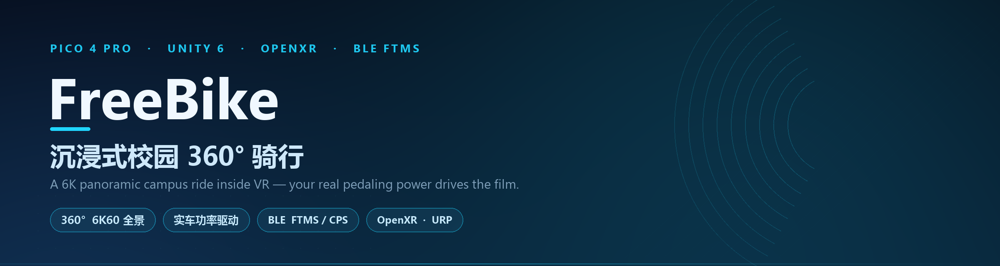
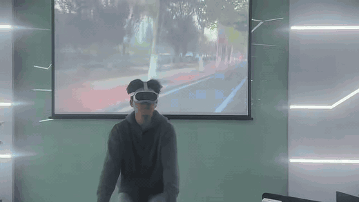
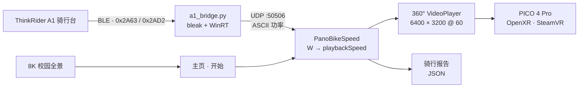
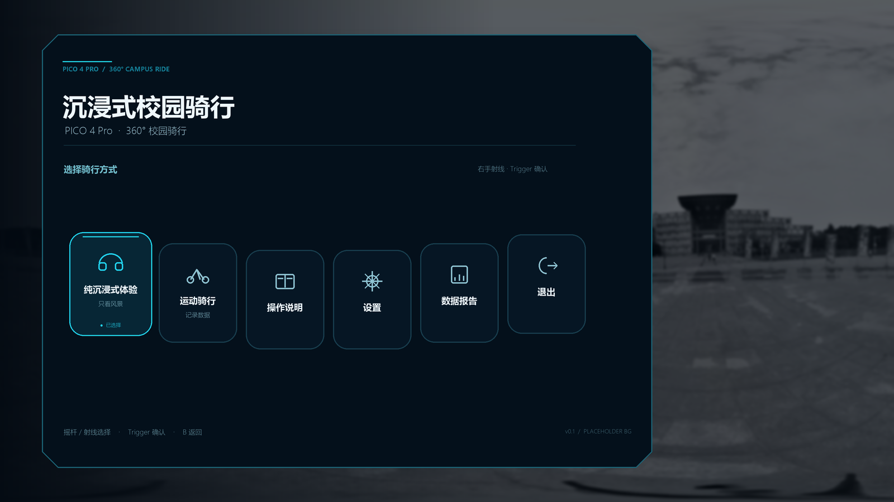
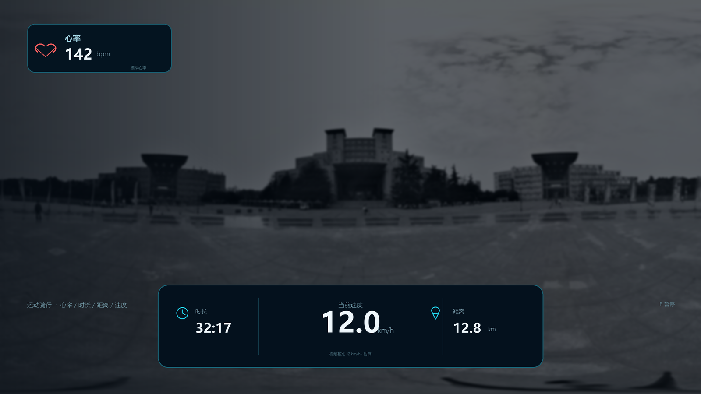
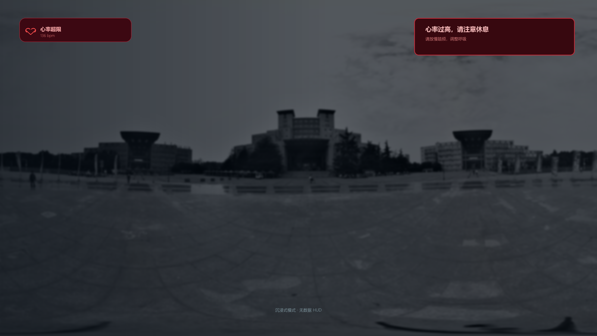
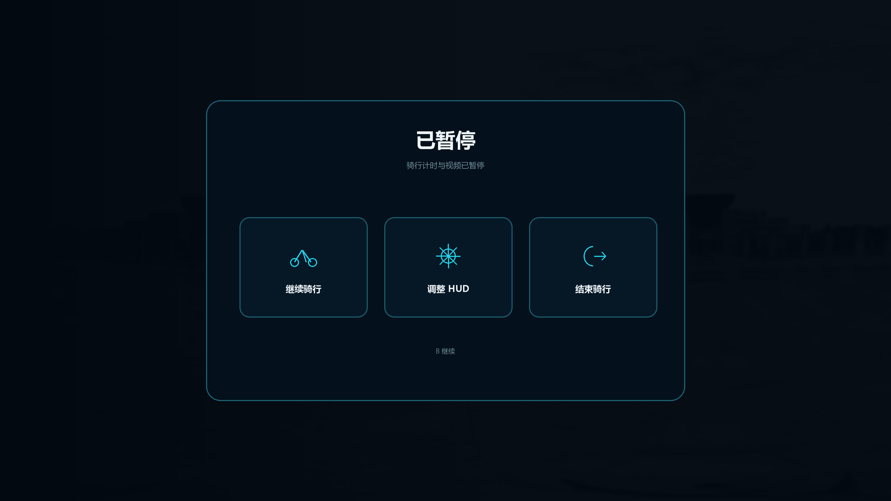
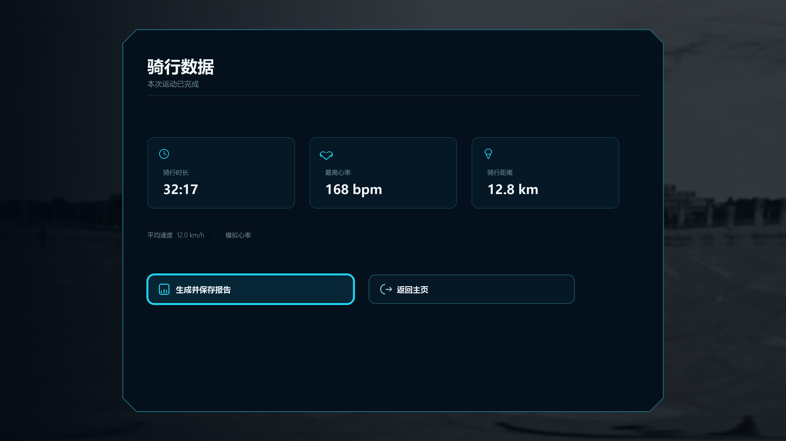
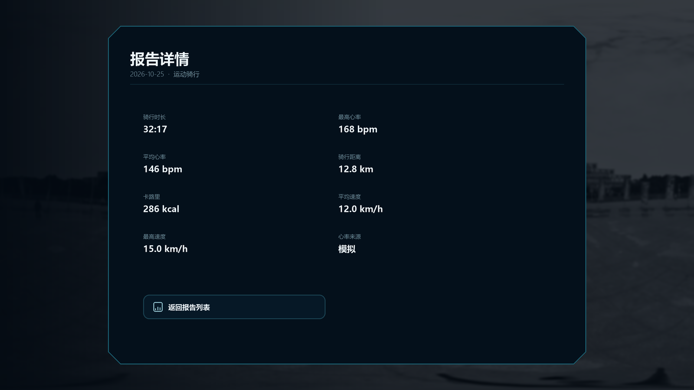

<div align="center">



# FreeBike · VR 沉浸式校园骑行
### VR Immersive Campus Cycling — PICO 4 Pro × Unity 6 × OpenXR

**把 6K 全景校园装进骑行台：真实功率驱动画面，踩多快，路就退多快**

[](https://github.com/leisure-Y101/VR-Immersive-Campus-Cycling/stargazers)
[](https://github.com/leisure-Y101/VR-Immersive-Campus-Cycling/network/members)
[](https://github.com/leisure-Y101/VR-Immersive-Campus-Cycling/commits/main)


**中文** · [English](#-english)

</div>

<div align="center">



**[▶ 看 19 秒完整原片（带声音）](Docs/demo/freebike-demo.mp4)**

</div>

---

> **你的每一次踩踏，都会变成校园后退的速度。**
>
> ThinkRider A1 骑行台的实时功率经 BLE 送进 Unity，直接驱动 6400×3200 全景影片的播放速率：
> 功率越大画面越快，脚一停，画面就钉在原地。

---

## ✨ 特性一览

| | 特性 | 说明 |
|---|---|---|
| 🎞️ | **6K60 全景影像** | 6400×3200 等距柱状球面播放，头动自由环视，无接缝 |
| 🚴 | **实车功率驱动** | 骑行台瞬时功率实时映射为播放速率，不是预录视频的"假互动" |
| 🛑 | **零功率即停** | 功率低于 5 W 直接暂停；不踩，车就不会动 |
| 📡 | **双协议解析** | BLE Cycling Power `0x2A63` 与 FTMS Indoor Bike `0x2AD2` 双通道并行 |
| 🔧 | **厂商固件适配** | 实测本机固件的帧偏移并分流解析，功率不再"漂到 1200 W" |
| 🖼️ | **8K 全景主页** | 7680×3840 等距柱状全景，手柄射线直选，无嵌套菜单 |
| 🎚️ | **极简交互** | 一个「开始」按钮；骑行中按住 B 唤起暂停，退出即回主页 |
| 🚦 | **场景叠加** | 红绿灯与行人低模按 yaw/pitch 锚定在 360° 球面上，转头不脱位 |
| 📈 | **骑行数据落盘** | 每次骑行写 JSON 报告，VR 内可直接浏览历史记录 |
| 🔌 | **进程解耦** | Unity 只监听 UDP，桥接端可任意替换语言与平台 |

---

## 🏗️ 系统架构



- **数据侧**：骑行台 → BLE 通知 → Python 桥接 → UDP 单播 → Unity 监听。全程标准 GATT，不依赖厂商 App 或私有 SDK。
- **画面侧**：Unity `VideoPlayer` 把全景片贴到内表面球体，播放速率由功率实时改写；暂停与恢复同步走同一路信号。
- **显示侧**：PICO 互联把 PC 渲染串流到头显，SteamVR 提供 OpenXR 运行时。

---

## 📸 界面

<div align="center">

| 主页 | 运动 HUD | 沉浸骑行 |
|:---:|:---:|:---:|
|  |  |  |
| **暂停** | **运动总结** | **报告详情** |
|  |  |  |

</div>

> 完整 16 屏设计稿见 [`Design/UI/preview`](Design/UI/preview)，拼版预览为 `00_contact_sheet.png`。

---

## 📦 目录结构

```text
FreeBike/
├── Assets/
│   ├── Scenes/            panoTest.unity（主场景）· PicoVideoBenchmark.unity
│   ├── Scripts/
│   │   ├── App/           主页 / HUD / 暂停 / 报告 的界面与状态机
│   │   ├── Bike/          BLE 数据源 · FTMS/CPS 解析 · 车把与转向
│   │   ├── Video/         360° 播放后端 · 码流叠加 · 性能基准
│   │   └── XR/            头姿驱动
│   ├── Resources/         8K 全景主页 · 内置字体
│   └── Environment/       校园场景与低模道具
├── Packages/              Unity 包 · PICO Integration 3.4.0
├── ProjectSettings/       Unity 工程设置
├── Tools/
│   ├── A1/                a1_bridge.py · scan_ble.py · inspect_a1.py
│   └── KinectSteering/    Kinect 转向实验
├── NativePlugins/         Android BLE 原生插件（Java）
├── Design/                UI 设计稿 · 自行车模型 · 参考图
└── Docs/                  技术文档 · 工作报告 · 运行时骑行报告
```

`Media/`（6K 原片）与 `Releases/`（Windows / Android 构建产物）体积过大，不随 Git 分发。

---

## 🧰 硬件清单

| 部件 | 型号 | 角色 |
|---|---|---|
| VR 头显 | **PICO 4 Pro** | 全景显示、头动与手柄追踪 |
| 骑行台 | **ThinkRider A1（Think A102）** | 瞬时功率 / 踏频数据源 |
| 主机 | **Windows PC + 独立显卡** | Unity 运行、6K 视频解码 |
| 串流 | PICO 互联 / PICO Connect | 头显 ↔ PC 低延迟串流 |
| 运行时 | SteamVR + OpenXR | XR 会话与输入 |

---

## 🛠️ 软件栈

| 环节 | 技术 |
|---|---|
| 引擎 | **Unity 6000.6.6f1** · URP 17.6.0 |
| XR | OpenXR 1.18.0 · XR Interaction Toolkit 3.6.1 · XR Management 4.6.1 |
| 头显 SDK | PICO Integration 3.4.0 |
| 视频 | Unity VideoPlayer · 等距柱状 360° 球面 · H.264 / HEVC |
| 骑行数据 | Python 3.14 · bleak · WinRT（Windows BLE） |
| 跨进程 | UDP `127.0.0.1:50506` · ASCII float |
| 构建 | Unity Build Profiles · Windows x64 / Android |

---

## 🚀 快速开始

### 1) 连接设备

1. 骑行台通电，踏板静止时靠近 PC。
2. PICO 4 Pro 开机，启动 **PICO 互联** 串流到 PC。
3. PC 端启动 **SteamVR**。

### 2) 启动功率桥接

```powershell
cd Tools\A1
python a1_bridge.py
```

终端开始滚出 `power= 168 W  flags=0x0820  raw=...` 即表示功率已进入 UDP。也可直接双击 `启动骑行台桥接.cmd`。

> 依赖 `bleak` + `winrt`，脚本会自动把 `Tools/deps/.pydeps-ble` 注入 `sys.path`。

### 3) 打开工程

1. Unity Hub → **Add** → 选择仓库根目录。
2. 用 **6000.6.6f1** 打开。
3. 打开 `Assets/Scenes/panoTest.unity`，点 Play。

### 4) 构建

| 平台 | 操作 | 产物 |
|---|---|---|
| Windows | 菜单 `FreeBike → Build Windows Campus Ride` | `Releases/Windows/CampusRideDemo/freebike.exe` |
| Android | `File → Build Profiles → Android`，Scene List 只勾 `panoTest.unity`，关闭 App Bundle | `Releases/Android/testbike<版本>.apk` |

---

## 🧠 关键技术

1. **功率 → 播放速率的非线性映射**

    `sqrt(power / 300)` 把 0–300 W 压成 0–1 的油门曲线，再经一阶平滑落到 `playbackSpeed`：轻踩就慢推，300 W 顶到 1.25×，松脚按 80 W/s 惯性回落，避免画面一顿一顿。

2. **零功率硬停**

    功率 < 5 W 直接 `Pause()`，而不是把速度压到 0。这条把「预录视频假装互动」和「真的在骑」区分开。

3. **GATT 逐字段跳过解析**

    FTMS `0x2AD2` 与 CPS `0x2A63` 都是 flags 驱动的变长帧：未置位的字段必须按规格跳过，错一位整帧就废。解析器全部带越界检查，圈数回绕用 `& 0xFFFF` 掩码差分换算踏频与速度。

4. **厂商固件适配**

    本机 A1 在 `flags=0x0820` 时把**瞬时功率写进「曲柄圈数」槽**，累计能量写在末槽，中间两槽恒 0。按标准解析会把累计能量当功率，读数一路涨到 1200 W。已按实测帧特征分流处理，两种固件都能读对。

5. **360° 世界锚定**

    红绿灯与行人低模不贴在屏幕空间，而是以 yaw/pitch 挂在球面半径 8 m 处，跟随视频时间轴切换红黄绿——头怎么转，灯都钉在路口。

6. **进程解耦**

    Unity 侧只认 `UDP:50506` 上的 ASCII 浮点数。桥接端 2 秒无数据自动回落到静止，桥接挂掉不会带崩客户端。

---

## 👀 操作方式

| 场景 | 操作 |
|---|---|
| 主页 | 手柄射线指向「开始」，Trigger 确认 |
| 骑行中 | 头动自由环视 360° 校园，无任何 HUD 遮挡 |
| 暂停 | 按住 **B** 约 0.25 秒，弹出「继续 / 退出」 |
| 面板选择 | 摇杆切换，Trigger 确认 |

---

## 📊 数据与报告

每次骑行结束写入 `Docs/RuntimeReports/CyclingReport/ride_YYYYMMDD_HHMMSS.json`：

```json
{
  "date": "2026-10-26 04:09:55",
  "mode": "Sport",
  "durationSec": 2.84,
  "distanceKm": 0.0,
  "caloriesKcal": 0.0,
  "avgHeartRate": 74.7,
  "maxHeartRate": 75.0
}
```

VR 内路径：**骑行数据 → 报告列表 → 报告详情**。

---

## ⭐ 支持

如果这个项目对你有启发，欢迎点个 **Star ⭐**。

也欢迎提 Issue 一起聊：全景骑行的画面同步、BLE 私有帧的逆向、VR 里的极简交互，都还有很大空间。

---

## 🌍 English

<div align="center"><b>FreeBike — VR Immersive Campus Cycling</b></div>

A VR cycling experience that rides a **6400 × 3200 panoramic campus film** on a **PICO 4 Pro**, driven end-to-end by the **real power output** of a ThinkRider A1 smart trainer.

- **Power-driven playback** — pedaling watts map to video speed through a `sqrt` throttle curve; zero watts means a hard pause.
- **Standard GATT only** — BLE Cycling Power (`0x2A63`) and FTMS Indoor Bike (`0x2AD2`) parsed field-by-field, no vendor SDK.
- **Firmware-tolerant** — detected and handled the trainer's non-standard power frame layout instead of trusting the spec blindly.
- **360° scene anchors** — traffic lights and pedestrians pinned in yaw/pitch on the video sphere, so they stay on the crossing when you look around.
- **Loose coupling** — Unity listens on `UDP:50506`; the bridge is a 100-line Python script you can replace with anything.

**Tech:** Unity 6000.6.6f1 · URP · OpenXR · XR Interaction Toolkit · PICO Integration SDK · Python/bleak · SteamVR.

> If this project helps you, a ⭐ is appreciated.

---

## 📄 素材与许可

| 组件 | 来源 |
|---|---|
| PICO Integration SDK | `Packages/com.unity.xr.picoxr` · PICO 官方许可 |
| Skybox 素材 | `xyz.staggartcreations.skyboxes` |
| 低模道具 | BrokenVector · Polyeler · Urban Props Pack (Rozity) |
| 校园全景影片 | 项目自摄，版权归拍摄方所有 |

第三方资源的使用范围以各自原始许可为准。
